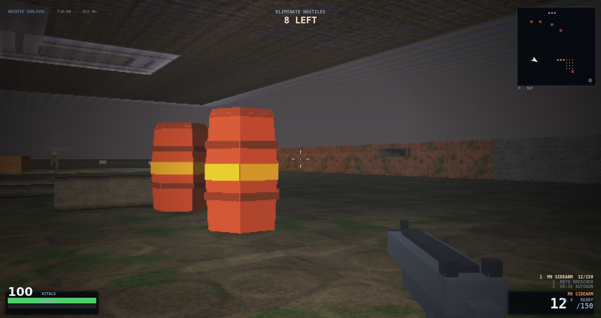
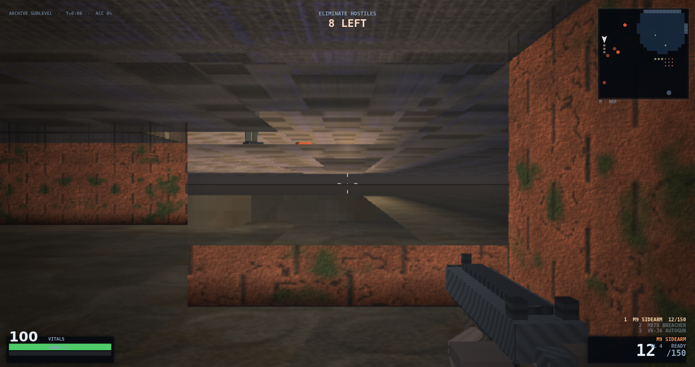
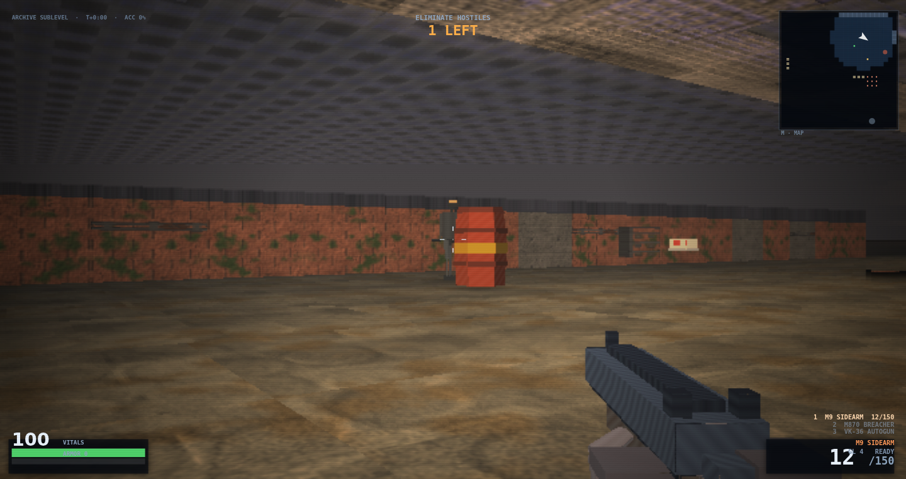
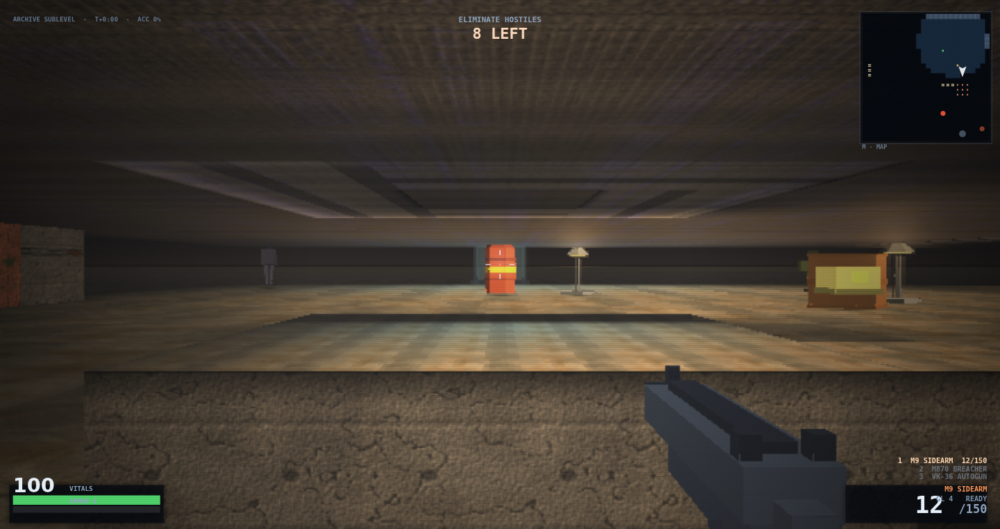
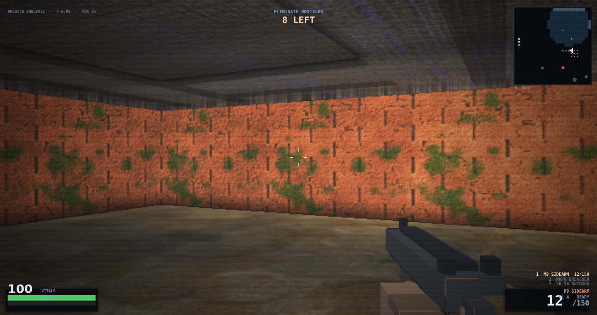
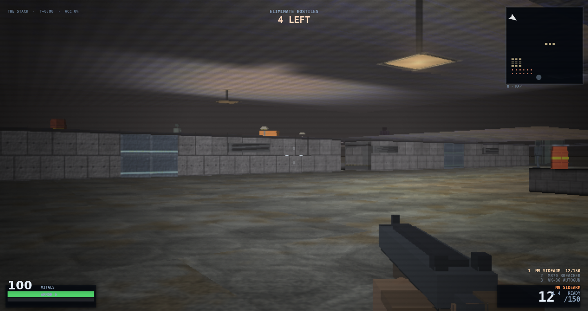
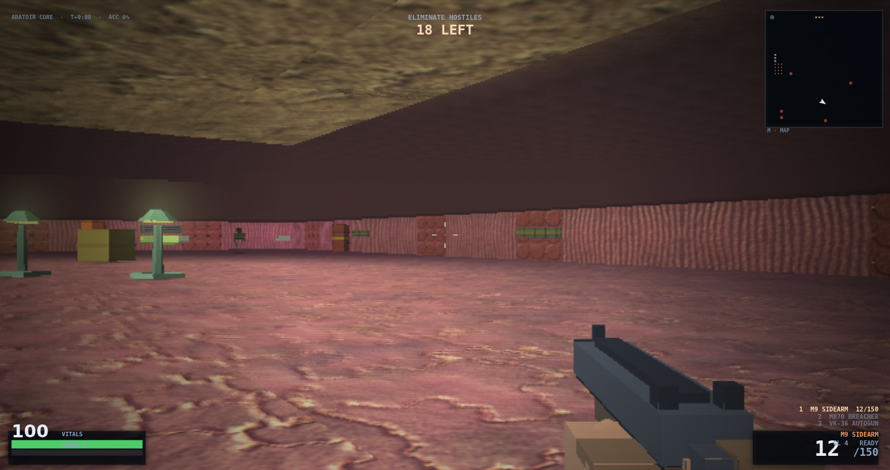
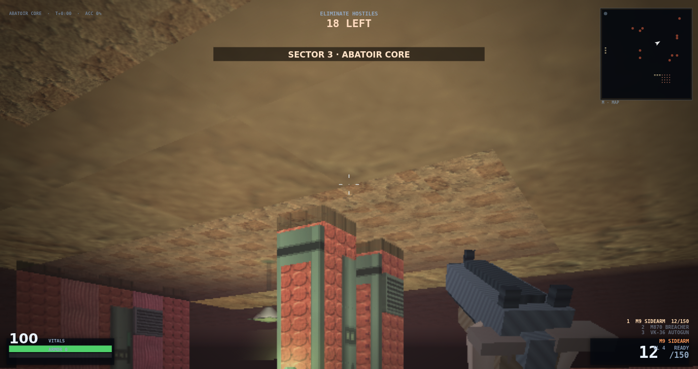

# BREACH PROTOCOL — browser FPS, zero dependencies

**Run it:** double-click `index.html` (or drag it into a browser window). No server, no build, no
internet, no assets — geometry, textures, sprites and sound are all generated at boot.
[Live site](https://lioreshai.github.io/breach-protocol-flash-next/) ·
[issues](https://github.com/lioreshai/breach-protocol-flash-next/issues) ·
[`docs/`](docs/README.md)

| file | what is in it |
|---|---|
| `index.html` | click this |
| `js/00_core.js` | utils, canvas, state, synthesized audio |
| `js/05_paint.js` | software rasteriser + the noise/SDF kit every asset is painted with |
| `js/10_assets.js` | material baker: albedo → normals → cavity AO → light, per texture |
| `js/11_rig.js` | the RIG sheets and pose cache — the bodies that ship are in `js/13_mesh.js` |
| `js/12_sprites.js` | props and decals, painted per frame from primitives |
| `js/13_mesh.js` | the bodies that ship: enemies and the first-person model |
| `js/20_level.js` | room/corridor generator, height grid, RGB lightmap, decals, occupancy |
| `js/30_entities.js` | weapons, player, enemy AI, projectiles, particles |
| `js/40_render.js` | software raycaster, post FX, 2D overlay/HUD |
| `js/50_ui_input.js` | menus, pointer lock, input, main loop |
| `js/90_dev.js` | the `?dev=1` console — inert without the flag |
| `tools/` | `smoke.js` pass/fail, `view.js` instruments, `recap.js` capture gate, `png.js` PNG writer |

## Controls
| | |
|---|---|
| `W A S D` / arrows | move |
| mouse | look (pointer lock; click the window to grab the mouse) |
| left click | fire · hold for auto weapons |
| right click | aim down sights (tighter spread, zoom) |
| `Shift` / `C` | sprint / crouch (crouching lowers your profile under incoming fire) |
| `Space` | jump |
| `R` | reload · `1 2 3` or mouse wheel | weapon select |
| `G` | grenade (area damage, chain-detonates barrels) |
| `Esc` | pause · `M` map · `T` sound · `F3` perf readout |
| `F4` | cycle quality: PERFORMANCE / BALANCED / ULTRA (`QUAL` in `js/40_render.js`) |

## The game
Three procedurally generated sectors — ARCHIVE SUBLEVEL, RING TRANSPORT, ABATOIR CORE — and one
hand-authored level, THE STACK. Clear every hostile in a sector, the exit portal opens, then find it.
Kills can drop health/ammo, barrels detonate when shot, headshots count double-plus, and difficulty
moves enemy damage, health and count.

## How it looks

Captured from the deployed build and refreshed by any merged PR that changes the picture. Which build
drew each frame, at what seed and by what route, is one row per file in
[`docs/screens/provenance.json`](docs/screens/provenance.json) — this page does not restate it, because
a byte claim written here is false by the next merge (#395). What *changed* between two recaptures is
in the PR that moved it, not here.

`node tools/recap.js check` decodes the eight PNGs and fails if any number below disagrees with the
bytes, so a caption cannot drift from its frame. The eight frames decode to **62.28 / 48.78 / 62.25 / 60.36 / 63.44 / 56.27 / 55.86 / 61.08** mean luma
(`0.2126 R + 0.7152 G + 0.0722 B`, the rule `DEV.lum` uses), in the order they appear below. A dark
row below means a row whose own mean luma is under 24 — the threshold the tool measures at, whatever
number a sentence labels.

All eight were re-taken in one pass off the deployed page at build `39d1a70`; the pass proved its build off the
wire by sha256-comparing all twelve served blobs against that tree before the shutter, so every frame below is the
picture the page draws, at the build its row names. Whether that is still today's picture is no longer a sentence
that ages: `node tools/recap.js check` hashes the four blobs that draw a frame — `index.html`, `js/10_assets.js`,
`js/20_level.js`, `js/40_render.js` — against the digests recorded for the bound build in
[`docs/screens/provenance.json`](docs/screens/provenance.json), and prints `SHIP-BIND` when this tree's bytes are
those bytes or `FRAME-STALE` naming the blob that moved. A pass aged badly once, binding `bd2441a` while two
render commits landed in review, and the tool exists so it cannot age quietly again; the bind is an upper bound on
"the picture changed", since a comment inside a renderer moves a digest and moves no pixel, so the row names the
blob and leaves the re-take call to a human. On the tree that carries this branch it prints `FRAME-STALE` for
`39d1a70`, naming `js/20_level.js`: the file that lights these rooms has moved on main since the build these rows
bind, so these frames are that build's picture and a re-take off a deploy of this one is owed (#578). Whether a
re-take carries a caption's coordinates or re-reads them is measured, not assumed, and it is not uniform: the same
url at one page load and one boot deals ARCHIVE SUBLEVEL as layout 3105224175 in the seat (18.5, 5.5) its five
captions already name — those five are the same rooms re-lit by the moved blob — while ABATOIR CORE re-rolls to
layout 706593863 in the seat (22.5, 13.5) where its two rows name 2728567296 in (20.5, 10.5), and THE STACK reads
layout 120030481 in the seat (1.5, 2.5) its row also names, so its authored map moved under the same seat. So five
frames carry their coordinates into the next pass and three must be read off the page again. That capture pass is
#578's next job, not this page's; what follows describes the pass that did land, which was the re-take the last few
merge cycles owed, so the picture moved further than a thin one. The ceiling's light term gained a floor and then a value of its own (#495, #369), a one-quantum step now
 declares geometry instead of shading a phantom lip (#517), an enemy's base is ink on the deck beside its feet
(#18), and the authored finale's cover is one crate rather than three unrelated boxes (#386). ARCHIVE SUBLEVEL's
spawn seat and its posed grunt came out 5.85 lumas darker — the roof reads as a lit surface at a lower value where
it used to read as a bright sheet — while that level's stairwell (+2.01), pit lip (+2.69) and pit floor (+1.30) came
out brighter. THE STACK lost 1.31, and that one has a specific author: PR #576 lowered the ceiling's base light on
two levels so their roof-to-wall junctions clear the 15-luma bar, and at the seat this frame is taken from the
junction gap went 7.1 → 16.0 luma while the ceiling band came down 52.1 → 42.1. ABATOIR CORE moved most (−12.60)
for another reason — **its deal re-rolled**, so that caption's coordinates now describe this build's room, and the
one other signature moved with it, THE STACK's (L3 1792722441, where the replaced row named 972763321). ARCHIVE
SUBLEVEL's signature held (3105224175), so the coordinates in its five captions still name the same rooms. Two dark
counts came back with these bytes: the pit-lip frame has 1 of 763 rows under the 24 bar where the frame it replaces
had none, and the stairwell's count at the tool's other bar rose from 15 rows to 18. Each row of `provenance.json` carries its own replaced-
frame mean so the direction is readable per frame rather than only in aggregate.

The shipped picture those numbers describe is the one the last pass introduced: a roof that is a lit surface
rather than a black sheet, because the ceiling's light term gained a floor (#495); an enemy's base that reads
against the deck it stands on (#18); a stair that draws its own step faces (#515); the face that caps your deck
wearing the room's own stone (#518); a crate with a surface instead of three flat colours (#533); and the line
where a room stops and its roof start drawn rather than implied (#369).
The deck within a couple of metres is fetched by the anisotropic tap pair (#467), so its near field reads as
continuous grain instead of texel steps. Each row of `provenance.json` still names the deal its frame came from, because what a URL deals
ages by build: the generator draws a different count between builds, so a re-take reloads the frame's own url
- one page load, one boot, never a second `DEV.boot()` inside the same load (`js/90_dev.js:21-22`) - and the
capture plan that makes these eight reproducible is written there, not here. Where a caption counts *darkness*
rather than geometry, the count below is the pass before this one's story told once and kept: the pit floor's 122
rows and THE STACK's 114 under the 34 bar became none at all when the roof was given a light floor (#495), and the
stairwell's 173 became 15 with its 79-row run gone (#431). This pass did not leave all of those where the last one
left them: the pit-lip frame is the one frame with a row under the 24 bar (1 of 763, where its predecessor had
none), and the stairwell came back from 15 to 18 rows under 34 with a 7-row run from row 630 where the last pass had
a single row at 18. The pit floor's and THE STACK's counts stayed at none.



The spawn seat (18.5, 5.5) on a lit datum floor — the seat this build's own deal puts you in, read off the
page rather than typed — **0 of 763 rows average below luminance 24**, no dark band left to count, mean 62.28,
thirds 53.6 / 60.0 / 73.2. This is the exposure the tonal gates are tuned against, and it is 0.13 darker than the
frame it replaces: the room is lit exactly as it was (#495's floor on the ceiling's light term is in both arms),
and all that moved under this camera is the value the roof takes where it meets a wall (#369). The light is the cell's own
ambient (`MAP.light` 0.8305 at (18,5)) and a fitting hangs in the seat's own cell at z 2.35. A barrel stands
2.83 m to the left and a crate about 5 m out ahead of you: that crate is the reason this frame was re-taken.
Its two visible faces now sit at different values — the face-orientation term carries its whole light, ambient
included — and its paint sits at the room's own brightness rather than a near-white card (#371, #476, #491).
At a near-tie azimuth the two faces still land close together and the box reads flatter than it should: the
term is per face, not per prop. The seat's own column carries four
units of authored air above it (`MAP.cz` 16, the ceiling solving at 4.00 over `floor 0.00`), so this is the
first place the ground pass's per-row ceiling term is allowed to do anything — it is exactly 0 while a plane
solves within 3.0 of the eye. The deck under the crosshair is the near field #467 changed: at this range the
footprint is 1-2 texels and the fetch is the anisotropic tap pair, which is why the four streak counts
`view.js mip` prints for the sectors fell when that pair landed.



Four risers in five cells: the flight at (1, 9) steps `MAP.fz` **0, 1, 2, 3, 4** up to (1, 13), three of those
cells flagged `MAP.feat` STAIR, seen from the tread below at (1.5, 8.5). **0 of 763 rows average below luminance 24**
(mean 48.78, band means 44.5 / 56.5 / 45.4; at the tool's other bar, 18 rows under 34, the longest unbroken run is
7 rows from row 630).
This deal's seat reads `MAP.light` 0.2489, so the air over the treads is dim, not empty, and the risers read
because their own faces are lit at different values (#371, #431). The dark block this caption used to count is
gone — 173 rows under 34 became 15 in the last pass, and this pass leaves 18, with a 7-row run from row 630 replacing
the single row at 18 that pass had — and two shipped changes account for the fall: the ceiling gained a light floor
(#495) and a stair now draws its own step faces instead of a warped flat deck (#515). Volume is authored room
by room, and a stairwell is not a room: no level has an overlook you can look *up* into yet
(#353, [`docs/VERTICALITY.md`](docs/VERTICALITY.md)).



One grunt 6 m out on the camera's own band — the spawn seat, then `DEV.clear()` and
`DEV.spawn('grunt', 1, 6)` (`kind, n, dist`), which is why the HUD reads **1 LEFT**. He lands at
(23.45, 8.89) on `MAP.fz` 0 like the camera, in a cell reading `MAP.light` 0.4223, and the light falls off
across him: the side turned toward the lamp reads brighter than the side turned away, because the face term now
covers a body's whole light, ambient included (#371). He is posed with `e.anim` pinned to **0**: rest pose, not
a stride (`view.js anim` gates motion). **0 of 763 rows average below luminance 24** here, mean 62.25, thirds
53.5 / 60.0 / 73.2; his base sits in a contact band that is flatter and deeper than the one he replaced (#18). Bodies are meshes from `js/13_mesh.js`; whether one
reads against the paint behind it at combat range is what `node tools/view.js contrast` prices (#416), and the
wall behind him in this frame is the repainted one.



The pit lip from 2.5 m out — camera **(20.5, 11.5)**, yaw **π/2**, feet on the datum, the lip plane
exactly 2.50 m ahead. **1 of 763 rows average below luminance 24**, the longest unbroken run is 1 row from row 537
(mean 60.36, band means 58.2 / 67.8 / 55.1; at the tool's other bar of 34, 15 rows, run 14 from row 536). The hole is the 3×3 block (19..21, 14..16) at `MAP.fz` **-4** with its own
ceiling at one unit, so a pit inside air the tall-air feature made tall stays a pit under a lip instead of
becoming a shaft; the lamp standing in it is at (19.5, 14.5) on band **-1.00**, 3.16 m from this camera, which
is this deal's placement rather than the 5 m the replaced frame could claim. The crate on the far side of the
lip is the frame's point: its two visible faces are no longer the same value, and its paint no longer
out-shines the room behind it (#476, #491). The pool of light is that lamp's own band, and the lip is lit by
the lane.



Standing in the hole at (19.5, 14.5), heading **atan2(2, 1) = 1.11 rad** so the lamp sits on the
crosshair: feet on **floor −1.00**, own ceiling **0.00**, `MAP.light` **0.3043** — barely a third of the spawn
seat's, and yet a frame mean of **63.44**, from a lamp standing in the camera's own cell. **0 of 763 rows
average below luminance 24, and none under 34 either** — the count the pass before this one removed from a
frame of the same room, and these bytes keep it removed: this is a lamp
working from inside the band it refuses from above, under a low ceiling the lamp itself already saturates.
This is the frame that moved most in the set and it moved **up** by 0.32, which is #518 and nothing else: the
low ceiling over the hole is now solved as the underside of the deck the camera is standing on instead of
being found by touch, so it stops reading as an unlit sheet — its own band went 46.6 → 47.4. The replaced
row explained this frame as having gone *down* 0.57 when the roof was lit; that was #495 measured against an
older arm, and these bytes do not show it. The floor under the crosshair is two units below the
spawn seat's band and comes off the same near-field fetch as that deck, which is why the pool falls off across
the hole instead of stepping texel to texel (#467).



**THE STACK**, the hand-authored level, from its spawn seat: (1.5, 2.5) on the datum, heading 0.60, 4
hostiles left, and **0 of 763 rows average below luminance 24** (mean 56.27, thirds 51.4 / 61.4 / 56.0; at the
tool's other bar, no rows at all — the count that came off when the roof was lit, and this pass left it at none). The seat's own cell carries a
ceiling at **1.00** — you are under the slab — and seven cells along the heading the plan opens into an
atrium whose ceiling solves at **4.00** over `floor 0.00`; `DEV.ray` along the heading stops 8.55 m out on a
face carrying `mat 10` = `WT.SLAB` drawn over the span `[0.00, 1.00]`. So what crosses the middle of the frame
is the wall of the room the seat opens into, with the atrium's lit floor visible above its top edge: a surface
you cannot shoot at, over a wall you can. That edge is carried by the surfaces themselves rather than by
the light on them — rectified ashlar blockwork with incised joints and tie holes over flagstone and moss
— so a lip reads as a lip at any distance, in bright light or dim, and not only where a lamp happens to
graze it (#428). You can read that in the frame: the blocks and their joints are legible out to the far end of
the wall, and the deck under them is a different stone rather than the same one lit differently. The stepped
glyphs on the minimap are the staircase that gets you up there. Hand-authoring removes the seed excuse — this
plan is written cell by cell over a 20 × 20 grid — and it also shows what is still missing:
`tools/view.js volume` reports this seat's headroom as `1.00..1.00`, so the level is genuinely two-storey
in `MAP.fz` and still reads as a low room with a bright slit in it (#353). What this pass takes back is the
darkness the last caption described: the vault is no longer the darkest large surface, its band runs **51.4**
against the deck's 56.0, and there is no dark block left to count, because #495 gave the ceiling a light floor
and this seat's slab top is a lit surface now. The plan is unchanged — THE STACK is written cell by cell — but the signature over it
moved, layout 1792722441 where the replaced row named 972763321, and the seat is still (1.5, 2.5) heading 0.60, so what moved between these bytes and the last pass is light and surface, not geometry:
the lit roof (#495), the roof-to-wall junction (#369), the riser material (#518) and the prop surface (#533),
on top of the ashlar family these faces already wore (#428). Which of them carries the point of luma is not
settled here; what is settled is that these bytes show the room that ships.



**ABATOIR CORE**, the room with the most ceiling in the game, from its own arrival seat (20.5, 10.5)
on the datum, heading 0.60, 18 hostiles left: **0 of 763 rows average below luminance 24** (mean 55.86, thirds
51.4 / 54.9 / 61.4). The top third reads **51.4** and the bottom **61.4**: the slab over the room is the
largest surface in frame and the darkest thing on it, and the crates on the deck sit nearer their room's own
value than any frame here showed before (#479, #491). This frame and the next are one page load at two
headings, because the two rows of one level have to name one deal — and read the seat before the numbers: this
level's deal moved with the level work that landed since the last pass (#421, #422), so the room dealt at this
seed is a different room again, layout 2728567296 where the replaced row named 469427782 (and 1812275020 before that). The coordinates the old
caption gave describe a floor plan that is no longer dealt, not a room that shifted. `tools/view.js surface`
prices the ceiling share and the slab-to-deck ratio; the frame itself only shows the split.



The same seat on the same deal, turned 0.554 rad right and pitched up 194 px, which is the solve that puts
this deal's nearest fitting on the crosshair: **0 of 763 rows average below luminance 24** (mean 61.08, thirds
60.8 / 72.0 / 50.4). Five fittings are hung over this room's circulation; the nearest is at (23.12, 8.88),
3.08 m from the seat, with its lens let down to **z 2.35** under a slab whose top solves at **4.00 m** here. The
pitch is not a taste number: `atan2(2.35 - eyeZ 0.50, 3.08) × BH 359` = 194 px, and at 3.08 m that lens sits
about 37° overhead, which is why the frame carries the rod, the lit panel and a band of the wall behind them
rather than the fitting and the room end to end — a ceiling that near is only drawn from about twice the eye
height in metres out (#413). So the height reads as a gap rather than as three parts of one object you can see
end to end, and it stops being something you discover by walking into it.

## How it works
* **Renderer** — software raycaster (Wolfenstein-style DDA) into an `ImageData`'s `Uint32Array` at
  ~0.5× resolution, upscaled to the window. Light, fog and tint are computed once per column, so each
  pixel costs one texture read, a few multiplies and a clamp.
* **Height** — a quantized per-cell grid (`ZQ = 0.25`), one playable band per column. The ground pass
  solves each pixel against the plane of the cell its own ray lands in, and collapses to the flat
  arithmetic bit for bit on a level with no altitude. Design:
  [`docs/VERTICALITY.md`](docs/VERTICALITY.md).
* **Billboards** (props, pickups, projectiles, portal) are depth-tested per pixel against what the
  ground and wall passes wrote, and alpha blended, so they are occluded correctly by walls and by the
  bodies in `js/13_mesh.js`, which write into the same depth. They get a small distance-based fill
  light, so an unlit prop is still a readable silhouette.
* **Pitch** is a screen shear, converted to a ray slope (`aimPx / BH`) for hit maths, so aiming at legs
  or heads agrees with the hit test. Recoil is a separate term that settles on its own and never pulls
  your vertical aim back to level.
* **Hitscan** is analytic (ray vs. enemy cylinder) rather than marched, so a shotgun blast costs almost
  nothing. A riser is a drawn face, not a solid cell, so it reports as a wall hit.
* **Levels** are rooms + L-corridors with flood-fill validation: unreachable space is rejected and
  spawns are nudged onto reachable cells, so a sector cannot become unwinnable.
* **Enemies** are state machines (sleep → chase → windup → melee/ranged) with line of sight,
  last-known-position tracking, wall sliding, side-stepping and separation steering. They cross bands
  where a staircase, ramp or ladder lets them, and not where it does not.
* **Audio** is pure WebAudio: filtered noise bursts and oscillator sweeps, stereo-panned by the angle
  to the source, over an ambient drone bed that thickens as you take damage.

## Tuning knobs
`js/00_core.js` → `cfg` (FOV, eye height, mouse sens), `js/30_entities.js` → `WEAPONS` / `ETYPE`
(damage, fire rate, enemy stats), `js/20_level.js` → `LEVELS` (map size, room count, spawn tables,
`amb`, `lampCol`, `fogCol`). Quality presets are the `QUAL` table in `js/40_render.js`.
`LEVELS[].rooms` is a target, not a promise — the placement loop keeps whatever it fits, so expect 4-6
rooms on any sector.

## Driving the game from a console (dev mode)
Append **`?dev=1`** and the game boots itself — no click, no pointer lock — and publishes one global,
`DEV`. Without the flag `js/90_dev.js` returns immediately: no globals, no wrappers, no behaviour
change, so the flag cannot leak into normal play. `DEV.help()` prints the list.

Append **`&seed=<int>`** too and the boot becomes reproducible (#166): the dev file installs the game's
own `mulberry` generator over `Math.random` before the deal, so one URL deals one level per build. With
no `seed` parameter `Math.random` is not touched at all. `&seed=` and `#seed=` parse the same way.

| Call | What it does |
|---|---|
| `DEV.boot()` | Start the run through the deploy button's own code path. |
| `DEV.cam(x, y[, z, ang, pitch])` | Park camera and player. `ang` is `P.ang` (radians, +x is 0). Rejects NaN; a position inside a solid cell is snapped out. |
| `DEV.look(dAng[, dPitch])` | Rotate in place. Never feeds `mouse.dx`, so it cannot walk the player into the void. `dPitch` is in **pixels**. |
| `DEV.face([enemy])`, `DEV.nearestEnemy()` | Aim at the nearest living enemy, or a given one. |
| `DEV.freeze([bool])` | Stop `update()` and pin the clock; rendering continues, so two screenshots of "the same frame" really match. |
| `DEV.tick([n])` | Exactly `n` update+render frames at `dt = 1/60`, no vsync. |
| `DEV.spawn(kind[, n, dist])`, `DEV.clear()` | Place `grunt\|hound\|brute` in a deterministic fan `dist` metres ahead — a target blocked by a wall steps sideways before it steps nearer, and no two bodies share a cell, so `n` bodies are `n` bodies in the frame. Returns `cells`, `collapsed`, `sep`, `placed[{x,y,cell,d,why}]`. |
| `DEV.set(name, value)` | Runtime overrides of the quality tier (`res, bloom, grade, grain, far, glow, rigH, rast, dmax, scan, vec, min, max`). |
| `DEV.tiers()` / `DEV.stats()` | The `QUAL` table as it stands; frame ms (`n/med/p95/last`), fps, buffer, draw calls, poses rasterised. |
| `DEV.state()` | JSON-safe snapshot: player (heading under `ang`), level, enemies, counts, `S` flags — plus `seed` (the uint32 pinning this deal, `null` if the URL named none) and `layout`. |
| `DEV.layoutSig()` | FNV-1a over `MAP.fz` then `MAP.cell`: the level's identity. Two boots of one seeded URL must agree and two unseeded boots must not. |
| `DEV.ray(x, y[, z], dx, dy, dz[, maxD])` | Step the real DDA and report the first wall: distance, cell, face. |

```
DEV.boot(); DEV.cam(4.5, 4.5, undefined, 0.6); DEV.freeze(true); DEV.tick(30)
DEV.spawn('brute', 1, 2); DEV.face(); JSON.stringify(DEV.stats())
DEV.ray(P.x, P.y, 0.5, Math.cos(P.ang), Math.sin(P.ang))   // is that wall actually there?
```

Four things that each cost a verification pass:

- **Aiming by console needs `mouse.down` too** — `update()`'s look step is gated on
  `S.locked || mouse.down` (`js/30_entities.js:326`) and `?dev=1` never holds pointer lock.
- **`DEV.ray` takes a vector.** `DEV.ray(0, 1.2)` reads as "pitch this ray up" and is a DDA starting
  *at cell (0, 1.2)*: an answer that agrees with whatever `hitscan` says, so it cannot be falsified.
- **`P.pitch` is in pixels**, clamped to `±BH * 0.62` and converted by `pitchTan()` — it reads 222.58
  where the shot's slope is 0.628. Quote `pitchTan()` when a number has to mean slope.
- **`DEV.set('rim', false)` is a dead switch.** Bodies became meshes in #72 and nothing in the draw path
  calls `RIG`, so it moves no pixel. Use `TINT=k` to A/B body shading.

## Judging the picture without a browser
`node tools/view.js <mode>` renders headlessly through the same code paths with no canvas pixel access
(the stub throws on `getImageData`, so assets cannot accidentally depend on one). `node tools/smoke.js`
is the pass/fail harness; `VERT=1` adds the vertical lane. The catalogue, which modes gate and which
only print, and the timing discipline are in
[`docs/DEVELOPMENT.md`](docs/DEVELOPMENT.md). The common ones:

| mode | what it tells you |
|---|---|
| `sheets`, `stats` | every material and sprite in one PNG; per-texture mean, deviation, gradient, coverage, blown pixels |
| `exposure` | mean luminance over levels × seeds × view angles, as **medians of seeded rolls**, with recorded rows |
| `scene <level> [cam]` | one frame as a PNG plus its luminance stats; `WARM=1` turns the camera |
| `alt`, `heights`, `cull`, `sight`, `drop`, `planes`, `decal` | the vertical suite — bands, planes, occlusion, climbs, mark windows |
| `contrast`, `bands`, `mip`, `volume`, `surface` | legibility: silhouette vs background, band contrast, streaking, authored air, value order between surfaces |

One warning that applies to every brightness number: a level lays itself out with `Math.random`, so one
seeded roll at one fixed pose is a *view class*, not a property of the level — measured 21 to 137
composited mean across five spawn frames of one level (#155). Both brightness assertions therefore read
the median of seeded rolls and print the rolls. A seed names a deal *within* one environment: the
browser's seed 12345 folds to 2229721315 and the node harness's to 3367779095, because the two consume
different numbers of draws before generation. Quote the environment beside the seed.

## How work is tracked
Backlog, bugs and milestones are
[GitHub issues](https://github.com/lioreshai/breach-protocol-flash-next/issues), not lines in a markdown
file — an issue can be linked from the commit that closes it and a paragraph cannot.

* A PR body names its issue with `Closes #N` (or `Fixes #N`) **as plain text**. The keyword is required:
  on a squash merge a bare `#13` links the issue and leaves it open forever. `[no-issue]` is the opt-out.
* Feature PRs leave `CHANGELOG.md`, `release.json` and `release-policy.json` at main's contents; the
  product lead writes player-facing notes only in a `release/vX.Y.Z` PR
  ([`docs/RELEASE.md`](docs/RELEASE.md)).
* [`docs/ROADMAP.md`](docs/ROADMAP.md) keeps direction and the priority rubric. Status questions go to
  the tracker.

## Notes
* Chrome/Safari/Firefox all fine. Mouse look needs pointer lock, granted on the first click — that click
  does not also fire your weapon.
* On a hidpi display the renderer caps device pixel ratio at 1.5 and renders at ~34-62% window height
  depending on the preset, which keeps it at 60 fps on integrated graphics.
* Boot spends ~1.6 s baking materials and characters, once, before the menu draws.
* Crates and barrels are decoration, not cover — nothing but walls is solid, so sprites never block
  movement or line of sight.
* `T` toggles sound and prints AUDIO ON / AUDIO MUTED, which is how you tell a muted game from a broken
  one. A throwing `AudioNode` call disables sound and closes the context rather than propagating: an
  exception in `frame()` used to abort before `renderWorld()`, leaving the simulation stepping behind a
  still picture.

## Extending it
* **A material**: add an entry to the material list in `js/10_assets.js` and paint it with the `Surf`
  primitives from `js/05_paint.js`. Levels pick wall textures through `pickWallTex`; floor and ceiling
  variants are indexed by the same ids. Never read canvas pixels.
* **A prop**: paint it into `PROP` in `js/12_sprites.js`. Billboards are drawn, filtered and occluded
  for free.
* **An enemy species**: add an `ETYPE` row (speed, `stride`, `gait`, scale, hitbox height) plus its
  geometry in `js/13_mesh.js`. Rig units are fractions of body height so hitboxes and geometry cannot
  drift apart, and gait phase advances with *distance travelled* so a planted foot never slides.
* **A quality knob**: add the field to every row of `QUAL` and read it once in `setGfx`, or in the shader
  that owns it. Never branch on the preset index inside a pixel loop.
* **Verify** with `node tools/roster.js` — it replays every invocation `ci.yml`'s blocking steps run —
  and with the live page, which is the source of truth for anything you can see.

Working here? [`AGENTS.md`](AGENTS.md) is the working agreement,
[`docs/ENGINEERING.md`](docs/ENGINEERING.md) is the list of traps already paid for, and
[`docs/DEVELOPMENT.md`](docs/DEVELOPMENT.md) says what each probe can and cannot see.
