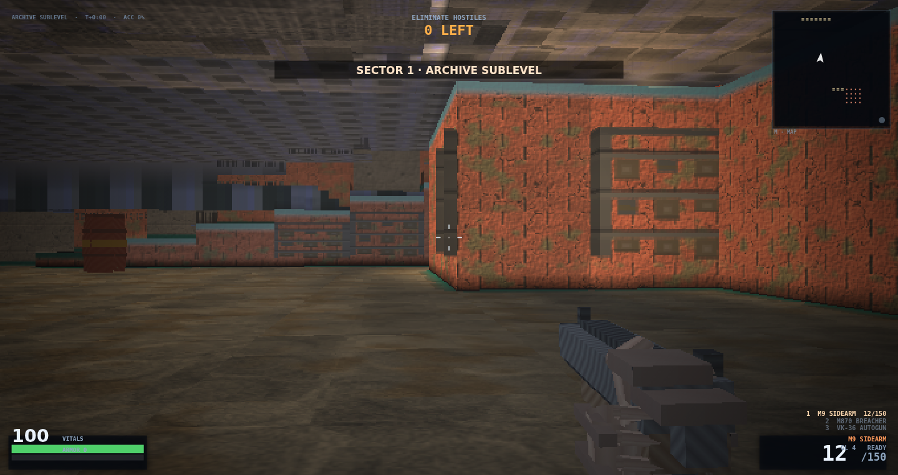
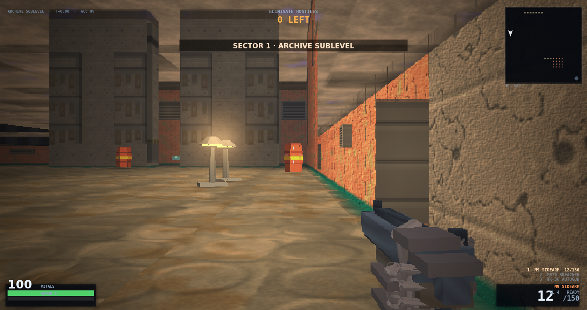
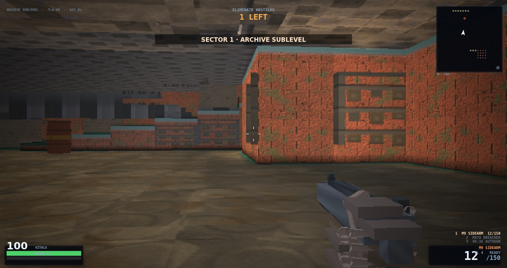
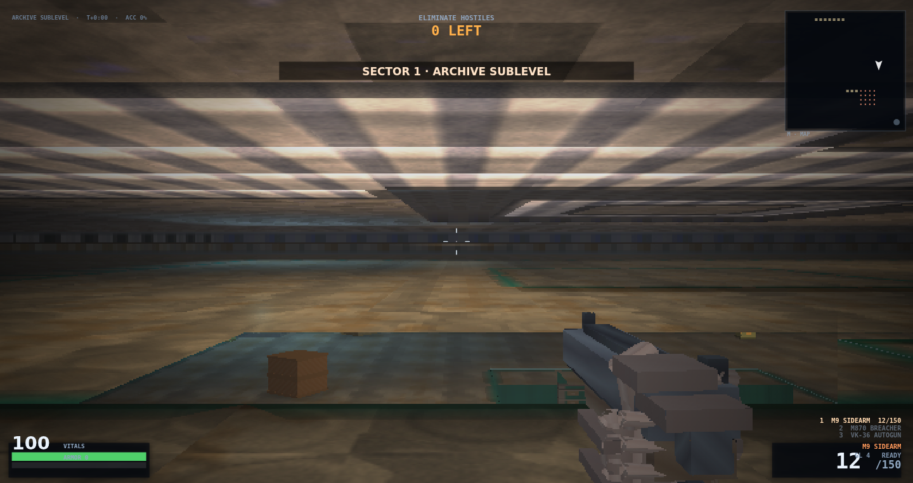
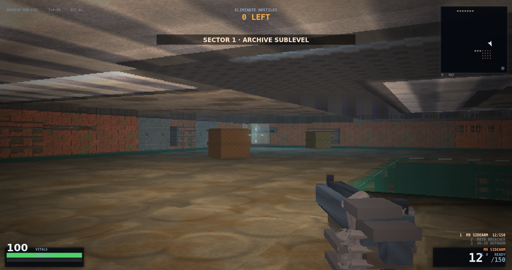
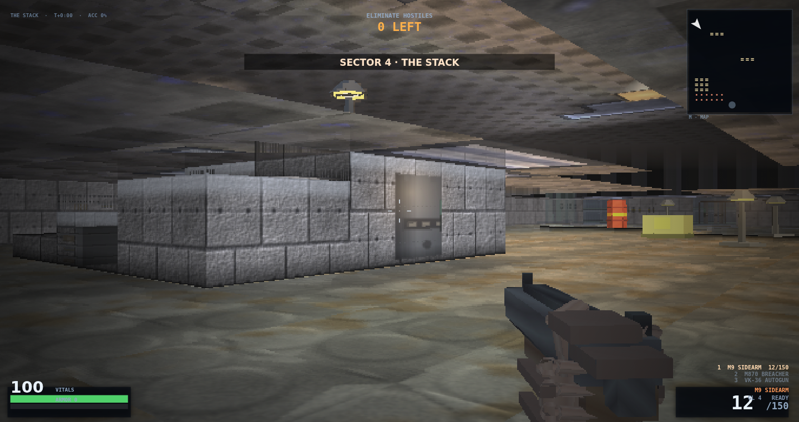
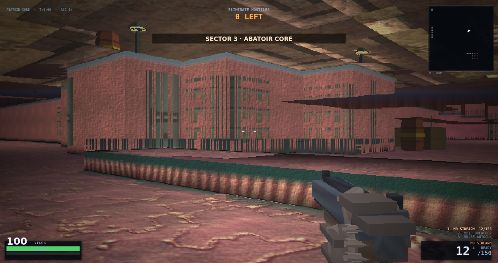
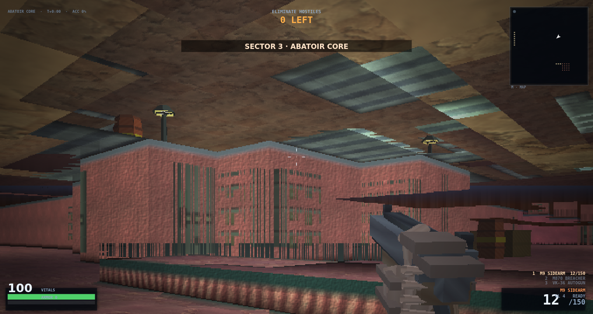

# BREACH PROTOCOL — browser FPS, zero dependencies

**Run it:** double-click `index.html` (or drag it into a browser window). No server, no build, no
internet, no assets — geometry, textures, sprites and sound are all generated at boot.
[Live site](https://lioreshai.github.io/breach-protocol-flash-next/) ·
[issues](https://github.com/lioreshai/breach-protocol-flash-next/issues) ·
[`docs/`](docs/README.md)

| file | what is in it |
|---|---|
| `index.html` | click this |
| `js/00_core.js` | utils, canvas, state, synthesized audio |
| `js/05_paint.js` | software rasteriser + the noise/SDF kit every asset is painted with |
| `js/10_assets.js` | material baker: albedo → normals → cavity AO → light, per texture |
| `js/11_rig.js` | the RIG sheets and pose cache — the bodies that ship are in `js/13_mesh.js` |
| `js/12_sprites.js` | props and decals, painted per frame from primitives |
| `js/13_mesh.js` | the bodies that ship: enemies and the first-person model |
| `js/20_level.js` | room/corridor generator, height grid, RGB lightmap, decals, occupancy |
| `js/30_entities.js` | weapons, player, enemy AI, projectiles, particles |
| `js/40_render.js` | software raycaster, post FX, 2D overlay/HUD |
| `js/50_ui_input.js` | menus, pointer lock, input, main loop |
| `js/90_dev.js` | the `?dev=1` console — inert without the flag |
| `tools/` | `smoke.js` pass/fail, `view.js` instruments, `recap.js` capture gate, `png.js` PNG writer |

## Controls
| | |
|---|---|
| `W A S D` / arrows | move |
| mouse | look (pointer lock; click the window to grab the mouse) |
| left click | fire · hold for auto weapons |
| right click | aim down sights (tighter spread, zoom) |
| `Shift` / `C` | sprint / crouch (crouching lowers your profile under incoming fire) |
| `Space` | jump |
| `R` | reload · `1 2 3` or mouse wheel | weapon select |
| `G` | grenade (area damage, chain-detonates barrels) |
| `Esc` | pause · `M` map · `T` sound · `F3` perf readout |
| `F4` | cycle quality: PERFORMANCE / BALANCED / ULTRA (`QUAL` in `js/40_render.js`) |

## The game
Three procedurally generated sectors — ARCHIVE SUBLEVEL, RING TRANSPORT, ABATOIR CORE — and one
hand-authored level, THE STACK. Clear every hostile in a sector, the exit portal opens, then find it.
Kills can drop health/ammo, barrels detonate when shot, headshots count double-plus, and difficulty
moves enemy damage, health and count.

## How it looks

Captured from the deployed build and refreshed by any merged PR that changes the picture. Which build
drew each frame, at what seed and by what route, is one row per file in
[`docs/screens/provenance.json`](docs/screens/provenance.json) — this page does not restate it, because
a byte claim written here is false by the next merge (#395). What *changed* between two recaptures is
in the PR that moved it, not here.

`node tools/recap.js check` decodes the eight PNGs and fails if any number below disagrees with the
bytes, so a caption cannot drift from its frame. The eight frames decode to **60.59 / 81.40 / 60.59 / 65.86 / 64.95 / 70.22 / 67.08 / 62.68** mean luma
(`0.2126 R + 0.7152 G + 0.0722 B`, the rule `DEV.lum` uses), in the order they appear below. A dark
row below means a row whose own mean luma is under 24 — the threshold the tool measures at, whatever
number a sentence labels. The same command subtracts, frame by frame, the mean of the frame each one
replaces — recorded per shot in `docs/screens/provenance.json` at the pass that superseded it — and
fails a caption whose quoted delta is not that difference, so a delta ages the way a mean does and
cannot be left behind by the pass it describes (#668).

This pass is the other half of that lesson: a mean can barely move while the picture still does. Three of the eight came
back *darker*, one lighter and five unchanged to two decimals, while between **0.00%** and **0.37%** of each picture
changed. The ARCHIVE lip pose keeps **0.37%** of its pixels differing from the bytes it replaces for **0.11** lumas
darker — the furthest of the eight — and the pit-floor deck **0.11%** for **0.02** darker. Both ABATOIR poses came back
with **no** pixel over the kept-pixel threshold and with means equal to four decimals: the byte that parted the bind is
the rule about the row at the edge of the deck you stand on, and neither ABATOIR pose has an edge in frame. The other
five — both ARCHIVE arrival poses, the posed grunt and THE STACK — moved between **0.02%** and **0.17%** of their
pixels for nothing at all in the mean, and every one of those differing pixels sits in the bottom third inside the
columns the held rifle occupies: the world did not move there, only the gun's pose between two page loads, which is the
disagreement #611 already names.
A delta is a statement about the exposure a room lands at, not about how much of the picture moved, which is why every
caption below states its kept-pixel percentage beside its mean.
Every row of `provenance.json` carries its own replaced-frame mean so the direction is readable per frame rather than
only in aggregate.

All eight were re-taken in one pass off the deployed page at build `b5b8b74`, whose one shipped change is what a reader
sees differently here: standing on a raised band, the strip of picture at the edge of your own deck used to be painted
as a wall face at the boundary's own distance, and it is now the deck up to the lip and whatever honestly stands behind
it, with a lit crease where the walkable surface stops (#517, `js/40_render.js`). That byte is one of the twelve the bind
below hashes, and it is the only blob that paints which moved since `f42f5ce` — which is why five of these eight frames
came back the same picture apart from the gun's pose between two page loads (#780, #892, `js/13_mesh.js`). The eight poses came back on the same
three layout signatures the replaced rows name — ARCHIVE 4083630493, ABATOIR 2343219222, THE STACK 3610925125 — so the
deltas below are a statement about paint, not about the dice. The pass supersedes the frames this page carries
(`f42f5ce`, re-taken by #914), and it proved its build off the wire before the shutter: `index.html` and
every script that page loads — twelve blobs — sha256-match `git show b5b8b74:<file>` twelve for twelve, so every frame
below is the picture that build's page drew, and the record now carries all twelve digests for it, read from the build
itself. Whether that is still today's picture is no longer a sentence
that ages: `node tools/recap.js check` hashes every blob the page serves — `index.html` and every script that build's own
`index.html` loads, twelve for `b5b8b74`, so no file that paints can be left out of the bind (#555) — against the digests
recorded for the bound build in
[`docs/screens/provenance.json`](docs/screens/provenance.json), and prints `SHIP-BIND` when this tree's bytes are
those bytes. When they differ it does not answer a pixel question with a hash: it paints the seats these rows were shot in
from both trees — that build's scripts out of git, this checkout's own, one harness write apart (`JSDIR`) — and prints
`FRAME-EQUIV` when every seat comes back byte-identical (the record needs a re-key and no shutter is owed) or
`FRAME-MOVED`, with the pixel count and the two means, when a seat paints differently (a re-take is owed). Where the
pixels cannot be asked — a shallow CI checkout has no history to read the other tree from — it prints `FRAME-STALE`
naming the blobs and says the render did not run. A pass aged badly once, binding `bd2441a` while two
render commits landed while a pass was in review, and the tool exists so it cannot age quietly again. On the tree that
carries these frames that row reads `SHIP-BIND` for `b5b8b74`: all twelve blobs the page serves are byte-identical here,
so these eight are this checkout's own picture and no re-take is owed. This is the second time that debt has come due,
and the first time it was opened by a shipped renderer byte rather than by a merge that moved nothing: #910 settled it
for `f42f5ce` after #908 parted the bind without repainting a seat, and #517 parted it again over a row that does. The
arbiter is what told the two apart both times — `FRAME-MOVED`, 16,880 of the 812,552 px of the seat it hashes, both
trees painted through the same `JSDIR` A/B. The same command also prints a
`CAPTION-VERDICT` row that compares this sentence with the digests, so the page cannot be left a pass behind by the
pass it describes (#653).

What a reader should take from the eight frames is that the rooms held and the paint moved. All three dealt signatures
came back identical to the ones the rows these frames replace name: ARCHIVE SUBLEVEL 4083630493, ABATOIR CORE 2343219222,
and THE STACK — hand-authored — still 3610925125. One instrument term did *not* come back readable: this pass's headless
loads had no audio output device, so `SND.init`'s `AudioContext` constructor returned before setting `SND.ac` and
`sampleRate` was never read off the page. Each row therefore carries the 44100 Hz its replaced row recorded, and says so
in its own note. #404's rule is the control read the other way: that term sets how many draws precede generation, so
had it moved the signatures would have moved with it, and all three did not (#404). So this is today's bytes drawing yesterday's room rather than a
new roll: every mean below is a statement about the deal the replaced frame already showed, and a delta below is a
statement about the paint. That is why every row there states its own sample rate, and why a signature is read as this
row's deal rather than as a property of the URL. It is also why no caption below states the
geometry of a deal — which cell holds the pit, how many risers stand in a run — because a sentence like that is true
of one roll and false of the next one. Three of the five ARCHIVE poses are recorded `DEV.cam` coordinates, so what is
held constant under a re-roll is the *camera*, not the sector. This pass re-ran the same url at one page load and one
boot per level, read every pose back out of the page that drew it, and read the seats back where the same deal put them:
the ARCHIVE spawn seat at (10.5, 10.5), ABATOIR CORE at (22.5, 13.5) on the bearing its own deal derives, 2.4228, and
THE STACK at (1.5, 2.5) on the heading its plan derives,
0.8761 - three seats identical to the ones the replaced rows name, which is the control that says the route held and the
deals did too. What is *not* restated
here is the interior the old captions quoted — a cell's `MAP.light`, which 3×3 block held the pit — because those
were re-read from the page that drew this frame, not carried forward (#420).

What moved the picture since the frames these replace is three surfaces and one hand. Walls stopped being one flat
value with noise painted over them: the mottle now comes out of the sheet's own resolution limit, so a face 6-14 m out
keeps its grain instead of being filtered to its mean and re-shuffled per texel (#889). Where a ray marches along a
wall, it now keeps looking past the fourth face, so what stands beyond a pit's lip is drawn rather than the level
stopping at the lip (#829). The end of a slab's underside joins the wall it lands on instead of fading into it (#421).
And at the hip the rifle's fore-end, magazine and knuckles are modelled and the shotgun's pump is no longer hidden
behind the fist gripping it (#780, #892) — nothing about aiming changes, the hand simply stops reading as a plate.
Between the two builds only `js/40_render.js` moved — one blob of the twelve that paint a frame — and it moved in one
rule about one row of one column. The bind now hashes every script the page's own `index.html` loads rather than four
hand-picked files, which is the hole #555 was filed for and the row above closes.
Per frame, in the order the eight appear below, the deltas to **0.00 / 0.00 / 0.00 / −0.11 / −0.02 / +0.01 / 0.00 / 0.00** mean luma; `recap`
computes each one from the two frames and names the row that disagrees, and a caption below repeats only its own
number. Two of the eight come back darker, one lighter and five unchanged to two decimals; the furthest
is the ARCHIVE lip pose at −0.11, and no pose moved more than four tenths of one per cent of its pixels: the byte that
parted the bind is the row at the edge of the deck you stand on, and only the two ARCHIVE poses that look at one show it.

The shipped picture those numbers describe is the one the last pass introduced: a roof that is a lit surface
rather than a black sheet, because the ceiling's light term gained a floor (#495); an enemy's base that reads
against the deck it stands on (#18); a stair that draws its own step faces (#515); the face that caps your deck
wearing the room's own stone (#518); a crate with a surface instead of three flat colours (#533); and the line
where a room stops and its roof start drawn rather than implied (#369).
The deck within a couple of metres is fetched by the anisotropic tap pair (#467), so its near field reads as
continuous grain instead of texel steps. Each row of `provenance.json` still names the deal its frame came from, because what a URL deals
ages by build: the generator draws a different count between builds, so a re-take reloads the frame's own url
- one page load, one boot, never a second `DEV.boot()` inside the same load (`js/90_dev.js:21-22`) - and the
capture plan that makes these eight reproducible is written there, not here. Where a caption counts *darkness*
rather than geometry, the count below is the pass before this one's story told once and kept: the pit floor's 122
rows and THE STACK's 114 under the 34 bar became none at all when the roof was given a light floor (#495), and the
stairwell's 173 became 15 with its 79-row run gone (#431). This pass moved one line — the edge of the deck you stand on — and
the softer bar barely moved with it: **none of the eight frames has a row under the 24 bar at all**. At the tool's
other bar one of them has anything to count, and it is the room rather than the HUD: the deck-edge lip **10 rows** in
an 8-row run from row 638. The other seven frames — both ARCHIVE arrival poses, the spawn seat, the posed grunt, the
pit-floor deck, both ABATOIR poses and THE STACK — count nothing at either bar, which is also exactly what the frames
these replace counted: 10 rows in an 8-row run from row 638 at the lip and nothing anywhere else, so the darkness
census is the one figure in this set that did not move.



The spawn seat (10.5, 10.5) on a lit datum floor — the seat this build's own deal puts you in, read off the
page rather than typed — **0 of 763 rows average below luminance 24**, no dark band left to count, mean 60.59,
thirds 60.3 / 63.9 / 57.5. It is **0.00** on the
frame it replaces - and the reason is the paint, not the dice: the layout is **4083630493**, the signature the row these
frames replace already named, and this instrument's audio term is the same 44100 Hz (#404), so this is the same room
drawn by today's bytes. **0.17%** of its pixels differ from those bytes by the kept-pixel rule — one pixel in
five hundred and eighty, for nothing at all in the mean — and all but 46 of them are the held rifle: 1,833 in the
bottom third and 46 in the middle, inside the columns the rig occupies over rows 495 to 762 and columns 901 to 1197, with
no differing pixel in the top third at all. The room is the one the replaced frame showed: the deck-edge rule this build
ships has no lip to paint from this seat, and neither had #904's stair-face tie-break or #518's floor answer. One page load refusing to agree with the next about where the gun sits is the whole of the difference (#611).
What the frame shows is the same room from the same recorded camera: the datum deck under a lit roof, a raised band ahead
wearing the lit edge of its own deck (#669), and the ashlar faces closing the room on both sides.
Those faces are the shipped picture this caption has kept across passes: two visible faces of one wall are no longer
one value — the face-orientation term carries its whole light, ambient
included — and their paint sits at the room's own brightness rather than a near-white card (#371, #476, #491).
At a near-tie azimuth the two faces still land close together and a box reads flatter than it should: the
term is per face, not per prop. The seat reads `floorAt` **0.00**, the same datum band the replaced frame's seat
stood on - the same quantized grid, a different cell, which is #548 writing height in rooms it used to leave at the
default - so this is the
first place the ground pass's per-row ceiling term is allowed to do anything, and it is exactly 0 while a plane
solves within 3.0 of the eye. The deck under the crosshair is the near field #467 changed: at this range the
footprint is 1-2 texels and the fetch is the anisotropic tap pair, which is why the four streak counts
`view.js mip` prints for the sectors fell when that pair landed. Where a lamp or a prop was standing in the replaced
frame is not restated here: prop placement comes out of the deal, and this deal is not the roll those bytes came from (#420, #757).



The tread at the end of a run of deck, seen at (1.5, 8.5) - the seat this pass read back, `floorAt` **0.00**,
heading π/2. **0 of 763 rows average below luminance 24**
(mean 81.40, band means 70.9 / 88.5 / 84.8; at the tool's other bar, nothing at all).
This deal puts no risers on this sight line, so the pose gives a long deck under a lit roof: the ashlar faces
closing the left, a brick face running away on the right with its base line lit, and a lamp or two standing mid-frame.
The air over the deck is dim, not empty, and this frame is
**0.00** on the frame it replaces -
which is the size of a repaint rather than of a different room: it is the same camera over ARCHIVE's 4083630493 deal,
the deal those bytes already carried, and 0.02% of its pixels differ from them by the kept-pixel rule — 196 of them, 192
in the bottom third inside the columns the held rifle occupies, 4 in the middle and none in the top, over rows 495 to
762 and columns 911 to 1186. This is the one pose in the set with no riser on the sight line, and it came back the same
picture: every differing pixel is the rig at the hip (#780, #892) and the load-to-load pose it carries (#611), not a
surface being fetched differently. The faces that are in frame read
because their own faces are lit at different values (#371, #431). There is no dark block left for this caption to count -
173 rows under 34 became 15 with the room-height pass (#431) and this deal's room leaves none at all - and two shipped changes
account for the long fall since the sentence above was written: the ceiling
gained a light floor
(#495) and a stair now draws its own step faces instead of a warped flat deck (#515). Volume is authored room
by room, and a stairwell is not a room: no level has an overlook you can look *up* into yet
(#353, [`docs/VERTICALITY.md`](docs/VERTICALITY.md)).



One grunt 6 m out — the spawn seat, then `DEV.clear()` and
`DEV.spawn('grunt', 1, 6)` (`kind, n, dist`), which is why the HUD reads **1 LEFT**; the load reads one hostile after
the clear-and-spawn, and the camera pose reads back (10.5, 10.5) on `floorAt` 0.00. The route's own seat search needed
no turn this deal: he stands dead on the view line 6.00 m out, with 255 raster px of him painted — the same seat and the
same coverage the replaced row read, which is what says the pose and the deal are the ones those bytes carried. The
brick face between the eye and his feet is why that is all of him the frame returns — the coverage mask in
`tools/livecap.js` counts the px his own draw took, and the deck he was dealt on stands behind a wall the shipped sight
rule marches past. The light falls off
across him: the side turned toward the lamp reads brighter than the side turned away, because the face term now
covers a body's whole light, ambient included (#371). He is posed with `e.anim` pinned to **0**: rest pose, not
a stride (`view.js anim` gates motion). **0 of 763 rows average below luminance 24** here — and nothing under 34 either — mean 60.59, thirds
60.2 / 63.9 / 57.6, **0.00** on the frame he replaces, and the same room the spawn seat
above it is about. It is not a re-deal: the layout is **4083630493** again, and **0.06%** of the frame's pixels differ
from those bytes by the kept-pixel rule — one pixel in sixteen hundred, for nothing at all in the mean, on
the same room the seat above it names. All 666 of them are in the bottom third, in the rig's own columns over rows 493
to 762 and columns 907 to 1191: the gun's pose between two page loads (#611) and nothing of the room or of him. Bodies are meshes from `js/13_mesh.js`; whether one
reads against the paint behind it at combat range is what `node tools/view.js contrast` prices (#416), and the
wall behind him in this frame is the repainted one.



The recorded lip pose — camera **(20.5, 11.5)**, yaw **π/2**, feet on `floorAt` **2.00** — and ARCHIVE
SUBLEVEL dealt from the same signature the row these frames replace names, so this is the same camera over the same
room. **0 of 763 rows average below luminance 24**, and no dark band left at that
bar (mean 65.86, band means 75.4 / 66.8 / 55.4; at the tool's other bar of 34 it counts 10 rows, an 8-row run from row
638 - the deck in the shadow of the edge you are standing on; the frame these replace counts the same 10 rows in the
same 8-row run from that same row). The frame is **−0.11** on the one
it replaces - the largest move of the eight - and it is one camera over the room it already showed: 0.37% of its pixels
differ from those bytes by the kept-pixel rule — 4,053 of them, none in the top third, 4 in the middle and 4,049 in the
bottom, over rows 495 to 762 and every column — so the room's own bands held at 75.4 and 66.8 while the bottom third
fell to 55.4. These differing pixels do not stay inside the rifle's columns the way the other seven's do: the run goes
edge to edge, because what moved is the deck up to the lip and the drop behind it (#517), not the hand holding the gun. The wall run the lip looks down is the largest surface in this
frame, and it came back the same surface: #889's sheet and #829's longer march were already inside these bytes.
This frame's HUD reads **0 LEFT**
because the capture route clears the room before it poses the camera, so no hostile this deal seats is standing in the
frame; the route is the shipped one (`devRoute` in tools/livecap.js), and every ARCHIVE pose below shares it. The edge
itself is what this pose exists for: the line where the walkable deck ends reads as a lit step (#669) rather than as a
seam you infer, and the room beyond it goes into the air colour. The prop at the right of the frame is the
point the last two passes were making: its two visible faces are no longer the same value, and its paint no longer
out-shines the room behind it (#476, #491).



The same pose the replaced row posed - (19.5, 14.5), heading **atan2(2, 1) = 1.11 rad**, feet on the datum slab at `floorAt` **0.00**, every
one of them read back off the load that drew this frame - and on the same deal those bytes sat on, so what those bytes
left as a pier is here a brick run with its own top edge lit (#669) and a crate's flank standing mid-frame. Frame mean
**64.95**; **0 of 763 rows average below luminance 24**, and nothing at all under the tool's softer 34 bar, where the
frame these replace counts nothing either. This frame is **−0.02** on the frame it
replaces - the second-furthest of the eight - over the same coordinates and ARCHIVE's 4083630493 deal, the deal those bytes
already carried, and 0.11% of its pixels differ from them by the kept-pixel rule. What
crosses the middle of the frame is the underside of a floor above this one - the dark band with lit deck under it -
which is what the room-height passes (#548, #421) put into the generator's own rooms, and it is the surface that moved
here. Of the 1,249 pixels that differ from the take this one replaces — 0.11% of the frame — none fall in the top
third, 8 in the middle and 1,241 in the bottom, over rows 493 to 762 and columns 903 to 1439: the picture below the
horizon band rewritten while everything above it held. That is the floor under the lip answering the plane your ray is
actually over rather than one further along (#518), and from this pass the row at the edge of your own deck answering the
deck instead of the boundary's wall (#517), on top of the held rifle's own columns (#780, #892); the underside's
own sheet (#886), the shadow band (#879), the joist pitch (#880), the sheet re-key (#19) and the wall beyond the lip
(#829) are all already inside the bytes this frame replaces, so they move nothing here. A frame mean a quarter of a luma
down with a seventy-eighth of the frame rewritten is a floor answering differently, counted a pixel
at a time when
its three channels differ by more than 18 in sum. Its top band reads 69.0
against the middle third's 56.7. The floor under the crosshair comes off the same near-field fetch as the
spawn seat's deck, which is why it falls off across the room instead of stepping texel to texel (#467).



**THE STACK**, the hand-authored level, from its spawn seat: (1.5, 2.5) on the datum, the derived heading 0.8761, the
route's clear leaving the HUD at **0 LEFT**, and **0 of 763 rows average below luminance 24** (mean 70.22, thirds 59.3 /
80.7 / 70.7; at the tool's other bar, no rows under 34 at all). The seat reads back at (1.5, 2.5) on `floorAt` **0.00**,
heading 0.8761, and the plan it sits in is the hand-written one. The heights the replaced caption read off that plan —
the slab over the seat, the opening the heading stops at, the span of the face crossing the middle of the frame — are
not restated here: #421 authored a storey into this plan since those numbers were taken, and this pass read the seat,
the layout and the luma off the page rather than re-solving the plan. What the frame shows is still the shape those
numbers were about: a wall you can shoot at, with a lit floor above its top edge that you cannot, and a barrel and a
crate standing in the room beyond it. That edge is carried by the surfaces themselves rather than by
the light on them — rectified ashlar blockwork with incised joints and tie holes over flagstone and moss
— so a lip reads as a lip at any distance, in bright light or dim, and not only where a lamp happens to
graze it (#428). You can read that in the frame: the blocks and their joints are legible out to the far end of
the wall, and the deck under them is a different stone rather than the same one lit differently. The stepped
glyphs on the minimap are the climb that gets you up there. Hand-authoring removes the seed excuse — this
plan is written cell by cell over a 20 × 20 grid — and it also shows what is still missing:
Whether this seat is genuinely under a second storey is a `tools/view.js volume` claim and this pass did not
re-read it; what the frame shows is a bright band over a lit deck, which is the shape #353 is about. The vault is still
not the darkest large surface, its band runs **59.3** against the deck's 80.6, and there is no dark block left to
count, because #495 gave the ceiling a light floor and this seat's slab top is a lit surface now. The plan is written
cell by cell and the seat is still (1.5, 2.5), and this frame is **+0.01** on the one it replaces - the smallest move in this
set, neither a wall arriving nor a room re-exposed - and the deal held:
layout **3610925125** is the signature the replaced row names, authored cell by cell, and the seeded stream that rolls
it was not re-cut. A delta that rounds to nothing is not nothing here:
**0.10%** of its pixels differ from the bytes it replaces by the kept-pixel rule - one pixel in a thousand four
hundred, and nowhere but the bottom of it: none in the top third, 374 in the middle and 681 in the bottom, rows 406 to
762 and columns 909 to 1282 touched. What
moved between these bytes and the last pass is the same paint as everywhere else in this set - the wall sheet's own
grain at the range the ashlar faces are actually looked at (#889), over the ashlar family they already wore (#428) -
plus the rig at the hip (#780, #892). The heights the replaced caption read off this plan -
the slab at 1.00 over the seat, the atrium opening at 4.00, where the heading's first face stops - are not restated,
because #548 authors height in the authored cells too and this pass did not re-solve them.



**ABATOIR CORE**, the room with the most ceiling in the game, from its own arrival seat (22.5, 13.5)
on the datum, on the bearing its own deal derives - 2.4228, since #859 retired the literal 0.6 every arrival used to be
pinned to - and 0 hostiles left after the route's clear: **0 of 763 rows average below luminance 24** (mean 67.08, thirds
58.8 / 64.6 / 77.9; at the tool's other bar, nothing at all). The top third reads **58.8** and the bottom **77.9**: the slab over the room is still the
largest surface in frame and the shaded underside of it the darkest thing on it, the raised deck mid-room wears the
lit edge of its own lip (#669), and the crates on the deck sit nearer their room's own
value than any frame here showed before (#479, #491). This frame and the next are one
url at two headings - one page load and one boot each, which is the route that re-deals a level rather than advancing
a stream (`js/90_dev.js:21-22`) - because the two rows of one level have to name one deal; and read the seat before the
numbers: this
level's deal is **2343219222**, the signature the row these frames replace already names, so the two frames are an A/B of
the shipped changes since those bytes and not of the dice (#420, #421). The seat, the bearing and the room all held, and
that is what makes this pair readable as a picture change: the delta here is **0.00**, and **no** pixel of the frame
reaches the kept-pixel threshold at all. ABATOIR CORE was the one sector whose authored `ceilLead` (#794) moved a still,
and that term was already inside the bytes this pass replaces; what moved since is the deck-edge row (#517), which this
arrival seat does not show. A held room and a held picture — the frame says so by being the same picture. A held room is worth nothing at all in aggregate and a twenty-fourth
of it in pixels; the layout field is what says so.
What the middle of this frame answers with is the point for #616: past the draw radius a pixel now reads the material
its own ray crossed, at the mip that footprint spans, so the far half of ABATOIR is stone going into the air colour
rather than one flat value, and the far wall keeps reading as stone as it recedes instead of flattening to one number.
The step-per-row figures the replaced caption quoted came off those bytes; this pass leaves them out rather than
restating them, because a transcribed step cannot be re-checked by the frame or by the tool that prices it. That far
half is still the darker half of the room, and that half of it is #199's. `tools/view.js surface`
prices the ceiling share and the slab-to-deck ratio; the frame itself only shows the split.



The same seat on the same deal, held on its own dealt heading and tilted up by a quarter of the raster height (`BH*0.25`,
read back as pitch 89.8): **0 of 763 rows average below luminance 24**, with nothing under 34
either (mean 62.68, thirds 57.4 / 69.5 / 61.3, and **0.00** on the frame it replaces, pose for pose).
**No** pixel of it reaches the kept-pixel threshold, and its mean agrees with the frame it replaces to four decimals:
the ceiling's exposure lead (#794), the slab joint (#421) and the sheet under it (#889) were all already inside the
bytes this pass replaces, and the deck-edge row this build ships (#517) is not in this frame. The seat reads back at (22.5,
13.5) on `floorAt` **0.00**, and the pose is the same tilt the replaced row took - `DEV.cam(P.x, P.y, undefined, P.ang,
BH*0.25)` - so the two frames stay comparable pose for pose, the heading coming from this build's own deal rather than
from the literal #859 retired. That is also why this caption names no fitting: the solve the
replaced row described put a fitting on the crosshair in a room that deal no longer lands, and on this deal the same
pitch lands on ceiling - two lit slab undersides meeting at a joint, with a band of the room's own wall along the
bottom of the frame and no rod, panel or fitting anywhere in it. The caption two passes back read that rod and panel
off its own deal, and a caption that keeps those words while the deal moves is describing a room nobody is standing
in. A ceiling that near is only drawn from about twice the eye
height in metres out (#413), so the height reads as a gap rather than as three parts of one object you can see
end to end, and it stops being something you discover by walking into it. The underside dims with the angle you read
it at (#810), which is what puts the ceiling bands at 57.4 and 69.5 over a wall band of 61.3.

## How it works
* **Renderer** — software raycaster (Wolfenstein-style DDA) into an `ImageData`'s `Uint32Array` at
  ~0.5× resolution, upscaled to the window. Light, fog and tint are computed once per column, so each
  pixel costs one texture read, a few multiplies and a clamp.
* **Height** — a quantized per-cell grid (`ZQ = 0.25`), one playable band per column. The ground pass
  solves each pixel against the plane of the cell its own ray lands in, and collapses to the flat
  arithmetic bit for bit on a level with no altitude. Design:
  [`docs/VERTICALITY.md`](docs/VERTICALITY.md).
* **Billboards** (props, pickups, projectiles, portal) are depth-tested per pixel against what the
  ground and wall passes wrote, and alpha blended, so they are occluded correctly by walls and by the
  bodies in `js/13_mesh.js`, which write into the same depth. They get a small distance-based fill
  light, so an unlit prop is still a readable silhouette.
* **Pitch** is a screen shear, converted to a ray slope (`aimPx / BH`) for hit maths, so aiming at legs
  or heads agrees with the hit test. Recoil is a separate term that settles on its own and never pulls
  your vertical aim back to level.
* **Hitscan** is analytic (ray vs. enemy cylinder) rather than marched, so a shotgun blast costs almost
  nothing. A riser is a drawn face, not a solid cell, so it reports as a wall hit.
* **Levels** are rooms + L-corridors with flood-fill validation: unreachable space is rejected and
  spawns are nudged onto reachable cells, so a sector cannot become unwinnable.
* **Enemies** are state machines (sleep → chase → windup → melee/ranged) with line of sight,
  last-known-position tracking, wall sliding, side-stepping and separation steering. They cross bands
  where a staircase, ramp or ladder lets them, and not where it does not.
* **Audio** is pure WebAudio: filtered noise bursts and oscillator sweeps, stereo-panned by the angle
  to the source, over an ambient drone bed that thickens as you take damage.

## Tuning knobs
`js/00_core.js` → `cfg` (FOV, eye height, mouse sens), `js/30_entities.js` → `WEAPONS` / `ETYPE`
(damage, fire rate, enemy stats), `js/20_level.js` → `LEVELS` (map size, room count, spawn tables,
`amb`, `lampCol`, `fogCol`). Quality presets are the `QUAL` table in `js/40_render.js`.
`LEVELS[].rooms` is a target, not a promise — the placement loop keeps whatever it fits, so expect 4-6
rooms on any sector.

## Driving the game from a console (dev mode)
Append **`?dev=1`** and the game boots itself — no click, no pointer lock — and publishes one global,
`DEV`. Without the flag `js/90_dev.js` returns immediately: no globals, no wrappers, no behaviour
change, so the flag cannot leak into normal play. `DEV.help()` prints the list.

Append **`&seed=<int>`** too and the boot becomes reproducible (#166): the dev file installs the game's
own `mulberry` generator over `Math.random` before the deal, so one URL deals one level per build. With
no `seed` parameter `Math.random` is not touched at all. `&seed=` and `#seed=` parse the same way.

| Call | What it does |
|---|---|
| `DEV.boot()` | Start the run through the deploy button's own code path. |
| `DEV.cam(x, y[, z, ang, pitch])` | Park camera and player. `ang` is `P.ang` (radians, +x is 0). Rejects NaN; a position inside a solid cell is snapped out. |
| `DEV.look(dAng[, dPitch])` | Rotate in place. Never feeds `mouse.dx`, so it cannot walk the player into the void. `dPitch` is in **pixels**. |
| `DEV.face([enemy])`, `DEV.nearestEnemy()` | Aim at the nearest living enemy, or a given one. |
| `DEV.freeze([bool])` | Stop `update()` and pin the clock; rendering continues, so two screenshots of "the same frame" really match. |
| `DEV.tick([n])` | Exactly `n` update+render frames at `dt = 1/60`, no vsync. |
| `DEV.spawn(kind[, n, dist])`, `DEV.clear()` | Place `grunt\|hound\|brute` in a deterministic fan `dist` metres ahead — a target blocked by a wall steps sideways before it steps nearer, and no two bodies share a cell, so `n` bodies are `n` bodies in the frame. Returns `cells`, `collapsed`, `sep`, `placed[{x,y,cell,d,why}]`. |
| `DEV.set(name, value)` | Runtime overrides of the quality tier (`res, bloom, grade, grain, far, glow, rigH, rast, dmax, scan, vec, min, max`). |
| `DEV.tiers()` / `DEV.stats()` | The `QUAL` table as it stands; frame ms (`n/med/p95/last`), fps, buffer, draw calls, poses rasterised. |
| `DEV.state()` | JSON-safe snapshot: player (heading under `ang`), level, enemies, counts, `S` flags — plus `seed` (the uint32 pinning this deal, `null` if the URL named none) and `layout`. |
| `DEV.layoutSig()` | FNV-1a over `MAP.fz` then `MAP.cell`: the level's identity. Two boots of one seeded URL must agree and two unseeded boots must not. |
| `DEV.ray(x, y[, z], dx, dy, dz[, maxD])` | Step the real DDA and report the first wall: distance, cell, face. |

```
DEV.boot(); DEV.cam(4.5, 4.5, undefined, 0.6); DEV.freeze(true); DEV.tick(30)
DEV.spawn('brute', 1, 2); DEV.face(); JSON.stringify(DEV.stats())
DEV.ray(P.x, P.y, 0.5, Math.cos(P.ang), Math.sin(P.ang))   // is that wall actually there?
```

Four things that each cost a verification pass:

- **Aiming by console needs `mouse.down` too** — `update()`'s look step is gated on
  `S.locked || mouse.down` (`js/30_entities.js:326`) and `?dev=1` never holds pointer lock.
- **`DEV.ray` takes a vector.** `DEV.ray(0, 1.2)` reads as "pitch this ray up" and is a DDA starting
  *at cell (0, 1.2)*: an answer that agrees with whatever `hitscan` says, so it cannot be falsified.
- **`P.pitch` is in pixels**, clamped to `±BH * 0.62` and converted by `pitchTan()` — it reads 222.58
  where the shot's slope is 0.628. Quote `pitchTan()` when a number has to mean slope.
- **`DEV.set('rim', false)` is a dead switch.** Bodies became meshes in #72 and nothing in the draw path
  calls `RIG`, so it moves no pixel. Use `TINT=k` to A/B body shading.

## Judging the picture without a browser
`node tools/view.js <mode>` renders headlessly through the same code paths with no canvas pixel access
(the stub throws on `getImageData`, so assets cannot accidentally depend on one). `node tools/smoke.js`
is the pass/fail harness; `VERT=1` adds the vertical lane. The catalogue, which modes gate and which
only print, and the timing discipline are in
[`docs/DEVELOPMENT.md`](docs/DEVELOPMENT.md). The common ones:

| mode | what it tells you |
|---|---|
| `sheets`, `stats` | every material and sprite in one PNG; per-texture mean, deviation, gradient, coverage, blown pixels |
| `exposure` | mean luminance over levels × seeds × view angles, as **medians of seeded rolls**, with recorded rows |
| `scene <level> [cam]` | one frame as a PNG plus its luminance stats; `WARM=1` turns the camera |
| `alt`, `heights`, `cull`, `sight`, `drop`, `planes`, `decal` | the vertical suite — bands, planes, occlusion, climbs, mark windows |
| `contrast`, `bands`, `mip`, `volume`, `surface` | legibility: silhouette vs background, band contrast, streaking, authored air, value order between surfaces |

One warning that applies to every brightness number: a level lays itself out with `Math.random`, so one
seeded roll at one fixed pose is a *view class*, not a property of the level — measured 21 to 137
composited mean across five spawn frames of one level (#155). Both brightness assertions therefore read
the median of seeded rolls and print the rolls. A seed names a deal *within* one environment: the
browser's seed 12345 folds to 2229721315 and the node harness's to 3367779095, because the two consume
different numbers of draws before generation. Quote the environment beside the seed.

## How work is tracked
Backlog, bugs and milestones are
[GitHub issues](https://github.com/lioreshai/breach-protocol-flash-next/issues), not lines in a markdown
file — an issue can be linked from the commit that closes it and a paragraph cannot.

* A PR body names its issue with `Closes #N` (or `Fixes #N`) **as plain text**. The keyword is required:
  on a squash merge a bare `#13` links the issue and leaves it open forever. `[no-issue]` is the opt-out.
* Feature PRs leave `CHANGELOG.md`, `release.json` and `release-policy.json` at main's contents; the
  product lead writes player-facing notes only in a `release/vX.Y.Z` PR
  ([`docs/RELEASE.md`](docs/RELEASE.md)).
* [`docs/ROADMAP.md`](docs/ROADMAP.md) keeps direction and the priority rubric. Status questions go to
  the tracker.

## Notes
* Chrome/Safari/Firefox all fine. Mouse look needs pointer lock, granted on the first click — that click
  does not also fire your weapon.
* On a hidpi display the renderer caps device pixel ratio at 1.5 and renders at ~34-62% window height
  depending on the preset, which keeps it at 60 fps on integrated graphics.
* Boot spends ~1.6 s baking materials and characters, once, before the menu draws.
* Crates and barrels are decoration, not cover — nothing but walls is solid, so sprites never block
  movement or line of sight.
* `T` toggles sound and prints AUDIO ON / AUDIO MUTED, which is how you tell a muted game from a broken
  one. A throwing `AudioNode` call disables sound and closes the context rather than propagating: an
  exception in `frame()` used to abort before `renderWorld()`, leaving the simulation stepping behind a
  still picture.

## Extending it
* **A material**: add an entry to the material list in `js/10_assets.js` and paint it with the `Surf`
  primitives from `js/05_paint.js`. Levels pick wall textures through `pickWallTex`; floor and ceiling
  variants are indexed by the same ids. Never read canvas pixels.
* **A prop**: paint it into `PROP` in `js/12_sprites.js`. Billboards are drawn, filtered and occluded
  for free.
* **An enemy species**: add an `ETYPE` row (speed, `stride`, `gait`, scale, hitbox height) plus its
  geometry in `js/13_mesh.js`. Rig units are fractions of body height so hitboxes and geometry cannot
  drift apart, and gait phase advances with *distance travelled* so a planted foot never slides.
* **A quality knob**: add the field to every row of `QUAL` and read it once in `setGfx`, or in the shader
  that owns it. Never branch on the preset index inside a pixel loop.
* **Verify** with `node tools/roster.js` — it replays every invocation `ci.yml`'s blocking steps run,
  including the nine modes named by its probe loop, read off that loop —
  and with the live page, which is the source of truth for anything you can see.

Working here? [`AGENTS.md`](AGENTS.md) is the working agreement,
[`docs/ENGINEERING.md`](docs/ENGINEERING.md) is the list of traps already paid for, and
[`docs/DEVELOPMENT.md`](docs/DEVELOPMENT.md) says what each probe can and cannot see.
