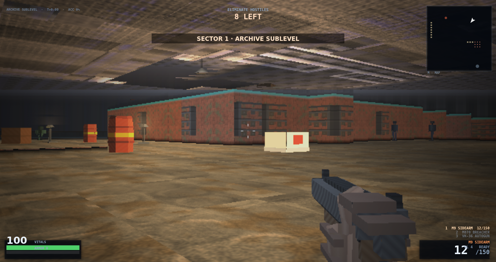
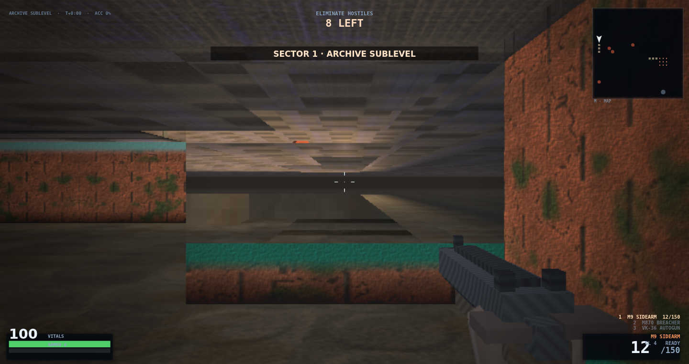
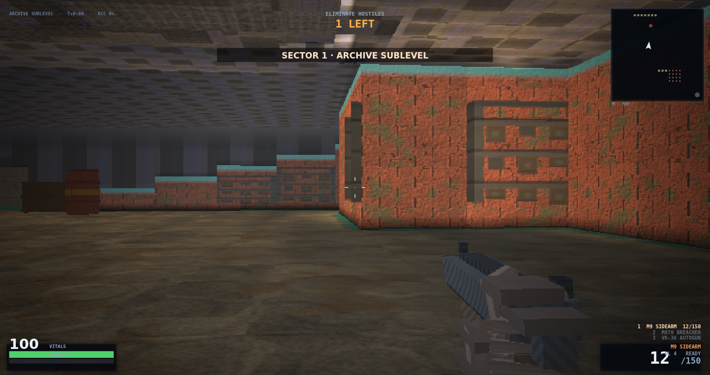
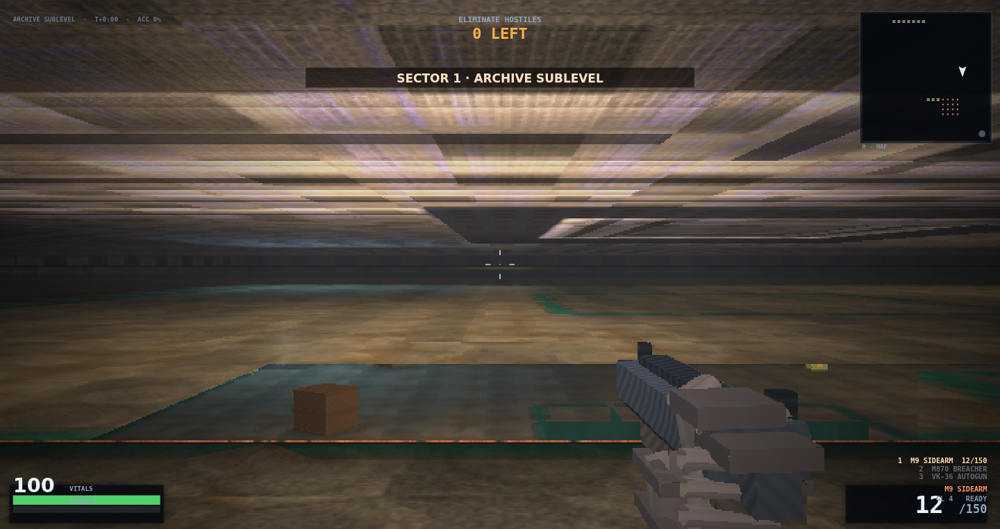
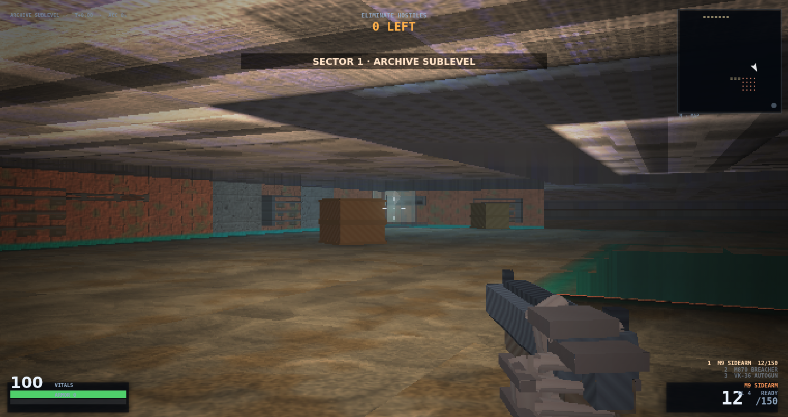
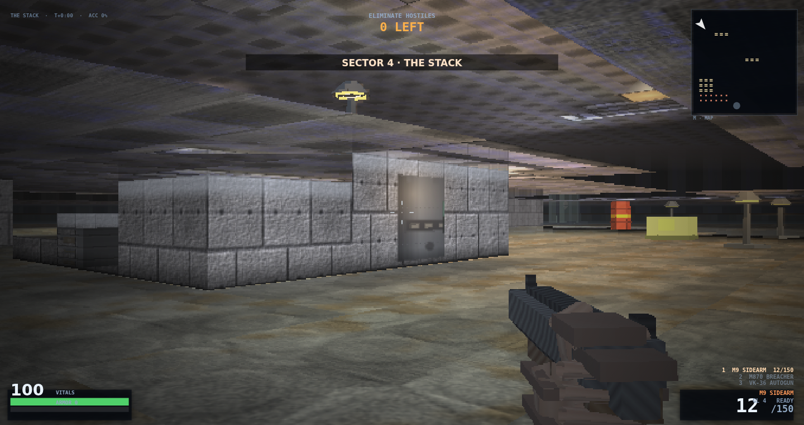
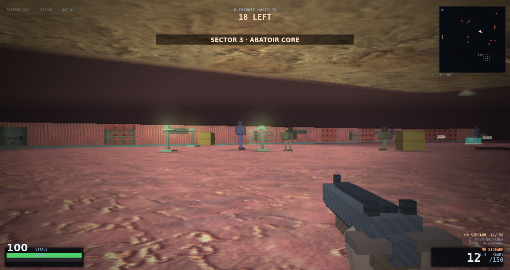
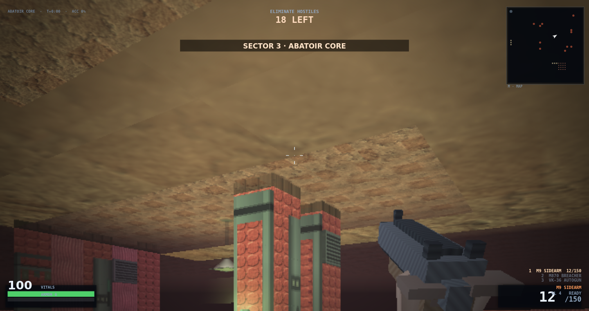

# BREACH PROTOCOL — browser FPS, zero dependencies

**Run it:** double-click `index.html` (or drag it into a browser window). No server, no build, no
internet, no assets — geometry, textures, sprites and sound are all generated at boot.
[Live site](https://lioreshai.github.io/breach-protocol-flash-next/) ·
[issues](https://github.com/lioreshai/breach-protocol-flash-next/issues) ·
[`docs/`](docs/README.md)

| file | what is in it |
|---|---|
| `index.html` | click this |
| `js/00_core.js` | utils, canvas, state, synthesized audio |
| `js/05_paint.js` | software rasteriser + the noise/SDF kit every asset is painted with |
| `js/10_assets.js` | material baker: albedo → normals → cavity AO → light, per texture |
| `js/11_rig.js` | the RIG sheets and pose cache — the bodies that ship are in `js/13_mesh.js` |
| `js/12_sprites.js` | props and decals, painted per frame from primitives |
| `js/13_mesh.js` | the bodies that ship: enemies and the first-person model |
| `js/20_level.js` | room/corridor generator, height grid, RGB lightmap, decals, occupancy |
| `js/30_entities.js` | weapons, player, enemy AI, projectiles, particles |
| `js/40_render.js` | software raycaster, post FX, 2D overlay/HUD |
| `js/50_ui_input.js` | menus, pointer lock, input, main loop |
| `js/90_dev.js` | the `?dev=1` console — inert without the flag |
| `tools/` | `smoke.js` pass/fail, `view.js` instruments, `recap.js` capture gate, `png.js` PNG writer |

## Controls
| | |
|---|---|
| `W A S D` / arrows | move |
| mouse | look (pointer lock; click the window to grab the mouse) |
| left click | fire · hold for auto weapons |
| right click | aim down sights (tighter spread, zoom) |
| `Shift` / `C` | sprint / crouch (crouching lowers your profile under incoming fire) |
| `Space` | jump |
| `R` | reload · `1 2 3` or mouse wheel | weapon select |
| `G` | grenade (area damage, chain-detonates barrels) |
| `Esc` | pause · `M` map · `T` sound · `F3` perf readout |
| `F4` | cycle quality: PERFORMANCE / BALANCED / ULTRA (`QUAL` in `js/40_render.js`) |

## The game
Three procedurally generated sectors — ARCHIVE SUBLEVEL, RING TRANSPORT, ABATOIR CORE — and one
hand-authored level, THE STACK. Clear every hostile in a sector, the exit portal opens, then find it.
Kills can drop health/ammo, barrels detonate when shot, headshots count double-plus, and difficulty
moves enemy damage, health and count.

## How it looks

Captured from the deployed build and refreshed by any merged PR that changes the picture. Which build
drew each frame, at what seed and by what route, is one row per file in
[`docs/screens/provenance.json`](docs/screens/provenance.json) — this page does not restate it, because
a byte claim written here is false by the next merge (#395). What *changed* between two recaptures is
in the PR that moved it, not here.

`node tools/recap.js check` decodes the eight PNGs and fails if any number below disagrees with the
bytes, so a caption cannot drift from its frame. The eight frames decode to **67.50 / 50.03 / 67.47 / 66.22 / 66.07 / 70.04 / 76.27 / 77.90** mean luma
(`0.2126 R + 0.7152 G + 0.0722 B`, the rule `DEV.lum` uses), in the order they appear below. A dark
row below means a row whose own mean luma is under 24 — the threshold the tool measures at, whatever
number a sentence labels. The same command subtracts, frame by frame, the mean of the frame each one
replaces — recorded per shot in `docs/screens/provenance.json` at the pass that superseded it — and
fails a caption whose quoted delta is not that difference, so a delta ages the way a mean does and
cannot be left behind by the pass it describes (#668).

All eight were re-taken in one pass off the deployed page at build `7a16776`; the pass proved its build off the
wire by sha256-comparing index.html and all eleven `js/` blobs served by that page against the tree that carries these frames before the shutter, twelve for twelve, so
every frame below is the picture that build's page drew. Whether that is still today's picture is no longer a sentence
that ages: `node tools/recap.js check` hashes the four blobs that draw a frame — `index.html`, `js/10_assets.js`,
`js/20_level.js`, `js/40_render.js` — against the digests recorded for the bound build in
[`docs/screens/provenance.json`](docs/screens/provenance.json), and prints `SHIP-BIND` when this tree's bytes are
those bytes or `FRAME-STALE` naming the blob that moved. A pass aged badly once, binding `bd2441a` while two
render commits landed in review, and the tool exists so it cannot age quietly again; the bind is an upper bound on
"the picture changed", since a comment inside a renderer moves a digest and moves no pixel, so the row names the
blob and leaves the re-take call to a human. On the tree that carries these frames that row reads `SHIP-BIND` for
`7a16776`: all four blobs that draw a frame are byte-identical between this checkout and the build the eight rows name, so no re-take is owed here and what is below is the picture this build's page draws. The reason this pass ran at all is the case that row cannot see: a bind can hold while the picture moves, because two merged PRs — the sight-line rule (#757) and the rule that keeps a moved prop on the deck it was dealt on (#768) — change where a hazard-banded crate or barrel stands when it sits in front of the room you wake in, and both of those changed a shipped blob while these frames were still bound to a build before them. So the eight were re-shot on the page this checkout deployed — that page's `index.html` and eleven `js/` blobs sha256-match this tree, twelve for twelve, read off the wire before the shutter — by the same route at the same coordinates. The same command now prints a `CAPTION-VERDICT` row that compares this sentence with the digests, so the page cannot be left a pass behind by the pass it describes (#653). All three of this pass's deals re-rolled, and the reason is the same class of change that made
the re-take necessary: the room-height passes author height in the generator's own dice, so one seed deals a
different sector at a later build. This pass re-ran the same url at one page load and one boot per level
and read every pose back out of the page that drew it. ARCHIVE SUBLEVEL re-rolled to 256590225 where its five
rows named 1898908958 — the generator's dice have moved twice since those bytes, once for the pier run (#631, landed
as #644) and once for the overlook relight (#676) — and four of those five poses are the recorded `DEV.cam`
coordinates, so what is held constant there is the *camera*, not the sector. ABATOIR CORE re-rolled to 4093107633,
its arrival seat reading back at (22.5, 13.5) where the frames these replace named 1425048100 at (24.5, 7.5). THE
STACK's hand-written plan keeps its cells and lost its bearing: signature 3610925125 where the replaced row named
1154765829, the seat still (1.5, 2.5), the heading now derived rather than the 0.60 those bytes posed. The seats are
read back, not carried, and this time they landed where the replaced rows put them: all three deals are the
signatures the rows already name — ARCHIVE SUBLEVEL 256590225, ABATOIR CORE 4093107633, THE STACK 3610925125 — so
these eight frames are an A/B of two shipped rules rather than of the generator's dice. That is the whole point of
the pass: the same camera, the same room, and a prop that no longer stands where it did. What is *not* restated
here is the interior the old captions quoted — a cell's `MAP.light`, which 3×3 block held the pit — because those
were re-read from the page that drew this frame, not carried forward (#420).

What moved the picture since the frames these replace is small and it is one thing: a hazard-banded crate or barrel
dealt in the centre band of the room you wake in is now placed clear of the sight line (#757), and once it has been
moved it stays on the deck it was dealt on instead of being dropped onto whatever slab the new cell sits over
(#768). Per frame, in the order the eight appear below, the deltas to **+0.20 / +0.05 / +0.20 / +0.39 / 0.00 / +0.29 / +0.20 / +0.05** mean luma; `recap`
computes each one from the two frames and names the row that disagrees, and a caption below repeats only its own
number. Six of the eight are a prop that changed cell seen from a camera that did not move; two of them — the riser
tread at (1.5, 8.5) and the pit-floor deck at (19.5, 14.5) — have nothing in that band on this deal, and there the
rule moved no pixel at all: those two frames differ from their predecessors only by the dither one page load draws
differently, with nothing past the harness's 18-per-channel floor anywhere in the frame. Every row of
`provenance.json` carries its own replaced-frame mean so the direction is readable per frame rather than only in
aggregate.

The shipped picture those numbers describe is the one the last pass introduced: a roof that is a lit surface
rather than a black sheet, because the ceiling's light term gained a floor (#495); an enemy's base that reads
against the deck it stands on (#18); a stair that draws its own step faces (#515); the face that caps your deck
wearing the room's own stone (#518); a crate with a surface instead of three flat colours (#533); and the line
where a room stops and its roof start drawn rather than implied (#369).
The deck within a couple of metres is fetched by the anisotropic tap pair (#467), so its near field reads as
continuous grain instead of texel steps. Each row of `provenance.json` still names the deal its frame came from, because what a URL deals
ages by build: the generator draws a different count between builds, so a re-take reloads the frame's own url
- one page load, one boot, never a second `DEV.boot()` inside the same load (`js/90_dev.js:21-22`) - and the
capture plan that makes these eight reproducible is written there, not here. Where a caption counts *darkness*
rather than geometry, the count below is the pass before this one's story told once and kept: the pit floor's 122
rows and THE STACK's 114 under the 34 bar became none at all when the roof was given a light floor (#495), and the
stairwell's 173 became 15 with its 79-row run gone (#431). This pass left those bars almost where they were, because
it moved props and not light: **none of the eight frames has a row under the 24 bar at all**. At the tool's other bar
six of them do: ABATOIR CORE's arrival seat **47 rows**
under 34 in a 47-row run from row 298, the riser seat 32 in a 12-row run from row 625, the spawn seat and the posed
grunt 26 each in a 26-row run from row 304, the pit-floor deck 9 in an 8-row run from row 98 and the pit lip 6 in a
6-row run from row 536. THE STACK and the up-tilted ABATOIR shot count nothing at either bar.



The spawn seat (18.5, 5.5) on a lit datum floor — the seat this build's own deal puts you in, read off the
page rather than typed — **0 of 763 rows average below luminance 24**, no dark band left to count, mean 67.50,
thirds 67.9 / 58.0 / 76.6. This is the exposure the tonal gates are tuned against, and it is **+0.20** on the
frame it replaces for a reason that is not a relighting and not a re-deal: the layout signature is the one the
replaced row already names, so the camera is in the same room, and the one thing that moved is a hazard-banded
barrel that used to stand in the middle of this sight line and is now dealt clear of it (#757, #768). What
the frame still shows is the same shipped picture: a wall face whose two visible faces are no longer one value, and a
roof that is a lit surface over the deck rather than a sheet.
Its two visible faces now sit at different values — the face-orientation term carries its whole light, ambient
included — and its paint sits at the room's own brightness rather than a near-white card (#371, #476, #491).
At a near-tie azimuth the two faces still land close together and the box reads flatter than it should: the
term is per face, not per prop. The seat reads `floorAt` **0.00**, the same datum band the replaced frame's seat
stood on - the same quantized grid, a different band, which is #548 writing height in rooms it used to leave at the
default - so this is the
first place the ground pass's per-row ceiling term is allowed to do anything, and it is exactly 0 while a plane
solves within 3.0 of the eye. The deck under the crosshair is the near field #467 changed: at this range the
footprint is 1-2 texels and the fetch is the anisotropic tap pair, which is why the four streak counts
`view.js mip` prints for the sectors fell when that pair landed. Where a lamp or a prop was standing in the replaced
frame is not restated here: prop placement comes out of the deal, and on this deal the rule that places it moved (#420, #757).



Four risers in five cells, seen from the tread below at (1.5, 8.5) - the seat this pass read back, `floorAt` **0.00**,
heading π/2. **0 of 763 rows average below luminance 24**
(mean 50.03, band means 45.8 / 59.1 / 45.2; at the tool's other bar, 32 rows under 34 in a 12-row run from row 625).
The air over the treads is dim, not empty, and this frame is **+0.05** on the frame it replaces, which is the
interesting kind of small: nothing on this sight line sits in the band the new placement rule looks at, so the rule
moved no pixel here and the difference is the dither one page load draws differently from the next. The risers read
because their own faces are lit at different values (#371, #431). The dark block this caption counts is the 12-row run
at the foot of the frame - 173 rows under 34 became 15 with the room-height pass (#431) and this deal's stairwell puts
32 of them back - and two shipped changes account for the long fall since the sentence above was written: the ceiling
gained a light floor
(#495) and a stair now draws its own step faces instead of a warped flat deck (#515). Volume is authored room
by room, and a stairwell is not a room: no level has an overlook you can look *up* into yet
(#353, [`docs/VERTICALITY.md`](docs/VERTICALITY.md)).



One grunt 6 m out on the camera's own band — the spawn seat, then `DEV.clear()` and
`DEV.spawn('grunt', 1, 6)` (`kind, n, dist`), which is why the HUD reads **1 LEFT**; the load reads one hostile after
the clear-and-spawn, and the camera pose reads back (18.5, 5.5) on `floorAt` 0.00. He lands on the same band as the
camera and the light falls off
across him: the side turned toward the lamp reads brighter than the side turned away, because the face term now
covers a body's whole light, ambient included (#371). He is posed with `e.anim` pinned to **0**: rest pose, not
a stride (`view.js anim` gates motion). **0 of 763 rows average below luminance 24** here — 26 of them under 34, in a
26-row run from row 304 — mean 67.47, thirds
67.8 / 58.0 / 76.6, **+0.20** on the frame he replaces, which is the same barrel off the sight line the spawn seat
above it is about rather than a relit room (#757); his base sits in a contact band that is flatter and deeper than the one he
replaced (#18). Bodies are meshes from `js/13_mesh.js`; whether one
reads against the paint behind it at combat range is what `node tools/view.js contrast` prices (#416), and the
wall behind him in this frame is the repainted one.



The recorded lip pose, 2.5 m out — camera **(20.5, 11.5)**, yaw **π/2**, feet on `floorAt` **0.00** — and ARCHIVE
SUBLEVEL dealt from the same signature as the replaced frame, so this is the same edge seen one rule later. **0 of 763 rows average below luminance 24**, and no dark band left at that
bar (mean 66.22, band means 65.0 / 70.0 / 63.7; at the tool's other bar of 34 it counts 6 rows, a 6-row run from row
536 - the far half of the room, which the replaced frame's room kept under the bar). The frame is **+0.39** on the one
it replaces, the largest move of the eight, and the move is one prop: the crate that stood in the centre band of this sight line is dealt clear of it now, and it stays on the deck it was dealt on rather than dropping to the slab under the new cell (#757, #768).
because this pass shot the pose off its own fresh page load instead of one that had been cleared, so the eight
hostiles this deal seats are in the frame rather than held back from it. The crate at the right of the frame is the
point the last two passes were making: its two visible faces are no longer the same value, and its paint no longer
out-shines the room behind it (#476, #491). The band of dark past them is the deal's doing, not the light's — #199
lifted that deck clear of the bar and this seed put it back down by moving the room (#420).



The same pose the replaced row posed - (19.5, 14.5), heading **atan2(2, 1) = 1.11 rad**, feet on the lower slab at `floorAt` **−1.00**, every
one of them read back off the load that drew this frame - and the same ARCHIVE SUBLEVEL deal, so the camera stands on
the deck of the room with a pier close on its left and a crate's flank filling the right, exactly where those bytes
left it. Frame mean **66.07**; **0 of 763 rows average below luminance 24**, and 9 rows under 34 in an
8-row run from row 98, where the last pass's room carried none at all. This frame is **0.00** on the frame it
replaces - the same coordinates over the same sector, with nothing in the centre band for the new placement rule to
move, so the two frames disagree by dither alone. What
crosses the middle of the frame is the underside of a floor above this one - the dark band with lit deck under it -
which is what the room-height passes (#548, #421) put into the generator's own rooms. Its top band reads 58.4
against the middle third's 88.5. The replaced
row explained this frame as having gone *down* 0.57 when the roof was lit; that was #495 measured against an
older arm, and these bytes do not show it. The floor under the crosshair comes off the same near-field fetch as the
spawn seat's deck, which is why it falls off across the room instead of stepping texel to texel (#467).



**THE STACK**, the hand-authored level, from its spawn seat: (1.5, 2.5) on the datum, the derived heading 0.8761, 4
hostiles left, and **0 of 763 rows average below luminance 24** (mean 70.04, thirds 60.0 / 80.6 / 69.7; at the
tool's other bar, no rows under 34 at all). The seat reads back at (1.5, 2.5) on `floorAt` **0.00**, heading 0.8761, 4 hostiles left, and the plan it sits in
is the hand-written one. The heights the replaced caption read off that plan — the slab over the seat, the opening
the heading stops at, the span of the face crossing the middle of the frame — are not restated here: #421 authored
a storey into this plan since those numbers were taken, and this pass read the seat, the layout and the luma off
the page rather than re-solving the plan. What the frame shows is still the shape those numbers were about: a wall
you can shoot at, with a lit floor above its top edge that you cannot. That edge is carried by the surfaces themselves rather than by
the light on them — rectified ashlar blockwork with incised joints and tie holes over flagstone and moss
— so a lip reads as a lip at any distance, in bright light or dim, and not only where a lamp happens to
graze it (#428). You can read that in the frame: the blocks and their joints are legible out to the far end of
the wall, and the deck under them is a different stone rather than the same one lit differently. The stepped
glyphs on the minimap are the climb that gets you up there. Hand-authoring removes the seed excuse — this
plan is written cell by cell over a 20 × 20 grid — and it also shows what is still missing:
Whether this seat is genuinely under a second storey is a `tools/view.js volume` claim and this pass did not
re-read it; what the frame shows is a bright band over a lit deck, which is the shape #353 is about. What this pass takes back is the
darkness the last caption described: the vault is no longer the darkest large surface, its band runs **60.0**
against the deck's 69.7, and there is no dark block left to count, because #495 gave the ceiling a light floor
and this seat's slab top is a lit surface now. The plan is written cell by cell and the seat is still (1.5, 2.5),
and this frame is **+0.29** on the one it replaces - because the signature over it did not
move: layout 3610925125 is the signature the replaced row already names, so what separates these bytes from those is
a prop that changed cell rather than a plan that changed, and on a hand-authored level the dice were never the
variable. What moved between these bytes and the last pass is the light in the air and the props standing in it:
the lit roof (#495), the roof-to-wall junction (#369), the riser material (#518) and the prop surface (#533),
on top of the ashlar family these faces already wore (#428). The heights the replaced caption read off this plan -
the slab at 1.00 over the seat, the atrium opening at 4.00, where the heading's first face stops - are not restated,
because #548 authors height in the authored cells too and this pass did not re-solve them.



**ABATOIR CORE**, the room with the most ceiling in the game, from its own arrival seat (22.5, 13.5)
on the datum, heading 0.60, 18 hostiles left: **0 of 763 rows average below luminance 24** (mean 76.27, thirds
68.4 / 71.0 / 89.5; at the tool's other bar, 47 rows under 34 in a 47-row run from row 298). The top third reads **68.4** and the bottom **89.5**: the slab over the room is still the
largest surface in frame and the darkest thing on it, and the crates on the deck sit nearer their room's own
value than any frame here showed before (#479, #491). This frame and the next are one page load at two
headings, because the two rows of one level have to name one deal — and read the seat before the numbers: this
level's deal is the one the replaced row already describes, layout 4093107633 with this deal's seat reading back at
(22.5, 13.5) where that row read it back too, so the two frames are an A/B of the placement rule and of the shipped
changes since those bytes rather than of the generator (#420, #421). The coordinates the older
captions gave describe floors plans that are no longer dealt, and that re-roll history is #420's
standing problem rather than a defect in this frame; it is also why the delta here is **+0.20** and not a story about
a different room. `tools/view.js surface`
prices the ceiling share and the slab-to-deck ratio; the frame itself only shows the split.



The same seat on the same deal, turned 1.15 rad right and pitched up 194 px, which is the solve that puts
this deal's nearest fitting on the crosshair: **0 of 763 rows average below luminance 24**, with nothing under 34
either (mean 77.90, thirds 79.0 / 92.4 / 62.3, and **+0.05** on the frame it replaces). The pose is the replaced row's verbatim - `DEV.cam(P.x, P.y, undefined, -0.5539, 194.07)` - so the two frames
stay comparable across the re-roll, and that is also why this caption no longer names a fitting: the coordinates
the old caption read off its own deal described a room this seed does not deal, and this pass read back the seat,
the layout and the luma rather than re-solving which panel the pitch lands on. What the frame carries is the rod,
the lit panel and a band of the wall behind them
rather than the fitting and the room end to end — a ceiling that near is only drawn from about twice the eye
height in metres out (#413). So the height reads as a gap rather than as three parts of one object you can see
end to end, and it stops being something you discover by walking into it.

## How it works
* **Renderer** — software raycaster (Wolfenstein-style DDA) into an `ImageData`'s `Uint32Array` at
  ~0.5× resolution, upscaled to the window. Light, fog and tint are computed once per column, so each
  pixel costs one texture read, a few multiplies and a clamp.
* **Height** — a quantized per-cell grid (`ZQ = 0.25`), one playable band per column. The ground pass
  solves each pixel against the plane of the cell its own ray lands in, and collapses to the flat
  arithmetic bit for bit on a level with no altitude. Design:
  [`docs/VERTICALITY.md`](docs/VERTICALITY.md).
* **Billboards** (props, pickups, projectiles, portal) are depth-tested per pixel against what the
  ground and wall passes wrote, and alpha blended, so they are occluded correctly by walls and by the
  bodies in `js/13_mesh.js`, which write into the same depth. They get a small distance-based fill
  light, so an unlit prop is still a readable silhouette.
* **Pitch** is a screen shear, converted to a ray slope (`aimPx / BH`) for hit maths, so aiming at legs
  or heads agrees with the hit test. Recoil is a separate term that settles on its own and never pulls
  your vertical aim back to level.
* **Hitscan** is analytic (ray vs. enemy cylinder) rather than marched, so a shotgun blast costs almost
  nothing. A riser is a drawn face, not a solid cell, so it reports as a wall hit.
* **Levels** are rooms + L-corridors with flood-fill validation: unreachable space is rejected and
  spawns are nudged onto reachable cells, so a sector cannot become unwinnable.
* **Enemies** are state machines (sleep → chase → windup → melee/ranged) with line of sight,
  last-known-position tracking, wall sliding, side-stepping and separation steering. They cross bands
  where a staircase, ramp or ladder lets them, and not where it does not.
* **Audio** is pure WebAudio: filtered noise bursts and oscillator sweeps, stereo-panned by the angle
  to the source, over an ambient drone bed that thickens as you take damage.

## Tuning knobs
`js/00_core.js` → `cfg` (FOV, eye height, mouse sens), `js/30_entities.js` → `WEAPONS` / `ETYPE`
(damage, fire rate, enemy stats), `js/20_level.js` → `LEVELS` (map size, room count, spawn tables,
`amb`, `lampCol`, `fogCol`). Quality presets are the `QUAL` table in `js/40_render.js`.
`LEVELS[].rooms` is a target, not a promise — the placement loop keeps whatever it fits, so expect 4-6
rooms on any sector.

## Driving the game from a console (dev mode)
Append **`?dev=1`** and the game boots itself — no click, no pointer lock — and publishes one global,
`DEV`. Without the flag `js/90_dev.js` returns immediately: no globals, no wrappers, no behaviour
change, so the flag cannot leak into normal play. `DEV.help()` prints the list.

Append **`&seed=<int>`** too and the boot becomes reproducible (#166): the dev file installs the game's
own `mulberry` generator over `Math.random` before the deal, so one URL deals one level per build. With
no `seed` parameter `Math.random` is not touched at all. `&seed=` and `#seed=` parse the same way.

| Call | What it does |
|---|---|
| `DEV.boot()` | Start the run through the deploy button's own code path. |
| `DEV.cam(x, y[, z, ang, pitch])` | Park camera and player. `ang` is `P.ang` (radians, +x is 0). Rejects NaN; a position inside a solid cell is snapped out. |
| `DEV.look(dAng[, dPitch])` | Rotate in place. Never feeds `mouse.dx`, so it cannot walk the player into the void. `dPitch` is in **pixels**. |
| `DEV.face([enemy])`, `DEV.nearestEnemy()` | Aim at the nearest living enemy, or a given one. |
| `DEV.freeze([bool])` | Stop `update()` and pin the clock; rendering continues, so two screenshots of "the same frame" really match. |
| `DEV.tick([n])` | Exactly `n` update+render frames at `dt = 1/60`, no vsync. |
| `DEV.spawn(kind[, n, dist])`, `DEV.clear()` | Place `grunt\|hound\|brute` in a deterministic fan `dist` metres ahead — a target blocked by a wall steps sideways before it steps nearer, and no two bodies share a cell, so `n` bodies are `n` bodies in the frame. Returns `cells`, `collapsed`, `sep`, `placed[{x,y,cell,d,why}]`. |
| `DEV.set(name, value)` | Runtime overrides of the quality tier (`res, bloom, grade, grain, far, glow, rigH, rast, dmax, scan, vec, min, max`). |
| `DEV.tiers()` / `DEV.stats()` | The `QUAL` table as it stands; frame ms (`n/med/p95/last`), fps, buffer, draw calls, poses rasterised. |
| `DEV.state()` | JSON-safe snapshot: player (heading under `ang`), level, enemies, counts, `S` flags — plus `seed` (the uint32 pinning this deal, `null` if the URL named none) and `layout`. |
| `DEV.layoutSig()` | FNV-1a over `MAP.fz` then `MAP.cell`: the level's identity. Two boots of one seeded URL must agree and two unseeded boots must not. |
| `DEV.ray(x, y[, z], dx, dy, dz[, maxD])` | Step the real DDA and report the first wall: distance, cell, face. |

```
DEV.boot(); DEV.cam(4.5, 4.5, undefined, 0.6); DEV.freeze(true); DEV.tick(30)
DEV.spawn('brute', 1, 2); DEV.face(); JSON.stringify(DEV.stats())
DEV.ray(P.x, P.y, 0.5, Math.cos(P.ang), Math.sin(P.ang))   // is that wall actually there?
```

Four things that each cost a verification pass:

- **Aiming by console needs `mouse.down` too** — `update()`'s look step is gated on
  `S.locked || mouse.down` (`js/30_entities.js:326`) and `?dev=1` never holds pointer lock.
- **`DEV.ray` takes a vector.** `DEV.ray(0, 1.2)` reads as "pitch this ray up" and is a DDA starting
  *at cell (0, 1.2)*: an answer that agrees with whatever `hitscan` says, so it cannot be falsified.
- **`P.pitch` is in pixels**, clamped to `±BH * 0.62` and converted by `pitchTan()` — it reads 222.58
  where the shot's slope is 0.628. Quote `pitchTan()` when a number has to mean slope.
- **`DEV.set('rim', false)` is a dead switch.** Bodies became meshes in #72 and nothing in the draw path
  calls `RIG`, so it moves no pixel. Use `TINT=k` to A/B body shading.

## Judging the picture without a browser
`node tools/view.js <mode>` renders headlessly through the same code paths with no canvas pixel access
(the stub throws on `getImageData`, so assets cannot accidentally depend on one). `node tools/smoke.js`
is the pass/fail harness; `VERT=1` adds the vertical lane. The catalogue, which modes gate and which
only print, and the timing discipline are in
[`docs/DEVELOPMENT.md`](docs/DEVELOPMENT.md). The common ones:

| mode | what it tells you |
|---|---|
| `sheets`, `stats` | every material and sprite in one PNG; per-texture mean, deviation, gradient, coverage, blown pixels |
| `exposure` | mean luminance over levels × seeds × view angles, as **medians of seeded rolls**, with recorded rows |
| `scene <level> [cam]` | one frame as a PNG plus its luminance stats; `WARM=1` turns the camera |
| `alt`, `heights`, `cull`, `sight`, `drop`, `planes`, `decal` | the vertical suite — bands, planes, occlusion, climbs, mark windows |
| `contrast`, `bands`, `mip`, `volume`, `surface` | legibility: silhouette vs background, band contrast, streaking, authored air, value order between surfaces |

One warning that applies to every brightness number: a level lays itself out with `Math.random`, so one
seeded roll at one fixed pose is a *view class*, not a property of the level — measured 21 to 137
composited mean across five spawn frames of one level (#155). Both brightness assertions therefore read
the median of seeded rolls and print the rolls. A seed names a deal *within* one environment: the
browser's seed 12345 folds to 2229721315 and the node harness's to 3367779095, because the two consume
different numbers of draws before generation. Quote the environment beside the seed.

## How work is tracked
Backlog, bugs and milestones are
[GitHub issues](https://github.com/lioreshai/breach-protocol-flash-next/issues), not lines in a markdown
file — an issue can be linked from the commit that closes it and a paragraph cannot.

* A PR body names its issue with `Closes #N` (or `Fixes #N`) **as plain text**. The keyword is required:
  on a squash merge a bare `#13` links the issue and leaves it open forever. `[no-issue]` is the opt-out.
* Feature PRs leave `CHANGELOG.md`, `release.json` and `release-policy.json` at main's contents; the
  product lead writes player-facing notes only in a `release/vX.Y.Z` PR
  ([`docs/RELEASE.md`](docs/RELEASE.md)).
* [`docs/ROADMAP.md`](docs/ROADMAP.md) keeps direction and the priority rubric. Status questions go to
  the tracker.

## Notes
* Chrome/Safari/Firefox all fine. Mouse look needs pointer lock, granted on the first click — that click
  does not also fire your weapon.
* On a hidpi display the renderer caps device pixel ratio at 1.5 and renders at ~34-62% window height
  depending on the preset, which keeps it at 60 fps on integrated graphics.
* Boot spends ~1.6 s baking materials and characters, once, before the menu draws.
* Crates and barrels are decoration, not cover — nothing but walls is solid, so sprites never block
  movement or line of sight.
* `T` toggles sound and prints AUDIO ON / AUDIO MUTED, which is how you tell a muted game from a broken
  one. A throwing `AudioNode` call disables sound and closes the context rather than propagating: an
  exception in `frame()` used to abort before `renderWorld()`, leaving the simulation stepping behind a
  still picture.

## Extending it
* **A material**: add an entry to the material list in `js/10_assets.js` and paint it with the `Surf`
  primitives from `js/05_paint.js`. Levels pick wall textures through `pickWallTex`; floor and ceiling
  variants are indexed by the same ids. Never read canvas pixels.
* **A prop**: paint it into `PROP` in `js/12_sprites.js`. Billboards are drawn, filtered and occluded
  for free.
* **An enemy species**: add an `ETYPE` row (speed, `stride`, `gait`, scale, hitbox height) plus its
  geometry in `js/13_mesh.js`. Rig units are fractions of body height so hitboxes and geometry cannot
  drift apart, and gait phase advances with *distance travelled* so a planted foot never slides.
* **A quality knob**: add the field to every row of `QUAL` and read it once in `setGfx`, or in the shader
  that owns it. Never branch on the preset index inside a pixel loop.
* **Verify** with `node tools/roster.js` — it replays every invocation `ci.yml`'s blocking steps run,
  including the nine modes named by its probe loop, read off that loop —
  and with the live page, which is the source of truth for anything you can see.

Working here? [`AGENTS.md`](AGENTS.md) is the working agreement,
[`docs/ENGINEERING.md`](docs/ENGINEERING.md) is the list of traps already paid for, and
[`docs/DEVELOPMENT.md`](docs/DEVELOPMENT.md) says what each probe can and cannot see.
